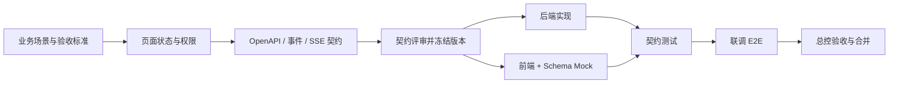
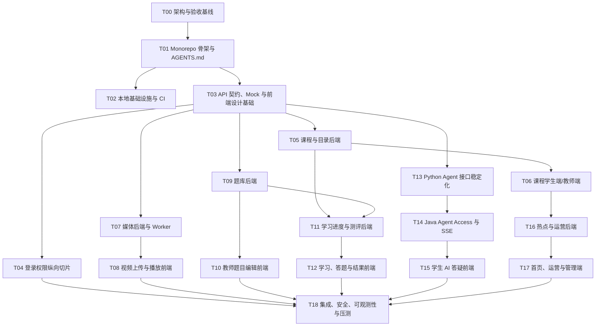

# 在线网课平台：Codex 实施与任务拆分指南

> 适用范围：Java 微服务、MySQL、Redis、Python 数学智能体，以及学生端、教师端、管理端三个 Vue 前端。

## 1. 结论：不要一个任务全做，也不要按类开几十个任务

推荐采用“一个总控任务 + 多个纵向功能任务 + 少量专项任务”的方式：

- **总控任务**维护架构、任务依赖、接口契约、集成状态和验收结果，不连续编写所有业务代码；
- **纵向功能任务**一次完成一个用户可验证的闭环，例如“教师上传视频并看到转码状态”，同时包含所需前端、API、服务、数据和测试；
- **专项任务**只处理不能自然放入纵向功能的基础设施，例如 CI、可观测性、压测和安全审计；
- 同时进行 2～4 个边界独立的任务即可。任务过多会增加契约冲突、重复实现和集成成本；
- 每个任务使用独立分支或 Worktree，合并前由总控任务核对契约、迁移、测试和文档。

不推荐两种极端：

1. **一个 Codex 任务实现整个平台**：上下文过大，容易跨模块做出未经确认的设计，最终难以审核和回滚。
2. **每个 Controller/页面/表单一个任务**：局部看似并行，实际会让 DTO、错误码、权限和交互状态各自演化，集成成本高于编码成本。

最合适的粒度通常是 1～5 个工作日可完成、能够独立演示、拥有明确验收标准的一条纵向切片。

## 2. 开工前建立唯一事实来源

先在仓库中固定以下文件，后续所有 Codex 任务都引用它们：

```text
AGENTS.md                         # 仓库规则、构建/测试命令、禁止事项
docs/architecture/system.md       # 总体架构和领域边界
docs/roadmap/backlog.md            # 任务编号、依赖、状态、负责人/任务链接
docs/api/*.yaml                    # OpenAPI 契约
docs/events/*.yaml                 # MQ 事件 Schema
docs/ai/sse-events.md              # AI SSE 事件与终止语义
docs/frontend/page-specs.md        # 路由、页面状态、权限和交互说明
docs/frontend/design-tokens.md     # 颜色、字号、间距、断点和组件约束
docs/adr/*.md                      # 重要架构决策记录
```

`AGENTS.md` 至少写明：

- 项目模块和所有权边界；
- Java、Python、前端的构建、Lint、测试命令；
- 数据库迁移、OpenAPI 生成和消息 Schema 校验方式；
- 不允许跨服务直接查表、不手写重复 DTO、不提交密钥、不绕过 Gateway；
- 变更完成标准和需要更新的文档；
- 工作区中已有改动的保护规则。

OpenAI 官方建议使用 `AGENTS.md` 告诉 Codex 如何导航仓库、运行测试并遵守项目约定；完成后仍应人工检查 diff、日志和测试结果：[Introducing Codex](https://openai.com/index/introducing-codex/)。

## 3. 前后端并行的前提：先冻结契约，再写实现

前端不能等待整个后端完成，但也不能凭页面原型猜接口。每个纵向功能按以下顺序执行：



契约至少包含：

- 请求、响应、分页、枚举、时间和金额格式；
- 401、403、404、409、422、429、5xx 的错误码和页面行为；
- 幂等键、版本号和重复提交语义；
- 权限与数据范围；
- 上传、转码、考试、AI 会话的状态机；
- SSE 事件类型、顺序、断线恢复、降级和终止条件；
- 示例数据，但示例不能替代 Schema。

契约冻结并非永不改变。若要修改，应先更新 Schema、兼容性说明和消费者，再修改实现；不要让某个任务偷偷改字段并要求其他任务追赶。

## 4. 推荐的仓库级任务依赖



## 5. 建议任务清单

| 编号 | 任务 | 主要交付物 | 可并行条件 |
|---|---|---|---|
| T00 | 架构与验收基线 | 架构文档、MVP 范围、SLO、ADR、任务图 | 第一个完成 |
| T01 | Monorepo 骨架 | Maven 多模块、Python 包、前端 Monorepo、`AGENTS.md` | T00 后 |
| T02 | 本地环境与 CI | MySQL、Redis、MQ、MinIO、基础流水线 | T01 后，可与 T03 并行 |
| T03 | 契约与前端基础 | OpenAPI、Mock、错误协议、设计令牌、三端路由壳 | T01 后，可与 T02 并行 |
| T04 | 身份权限切片 | IAM、Gateway 登录、三端登录/路由守卫、权限测试 | T03 后 |
| T05 | 课程与目录后端 | 课程版本、目录、发布审核 API 和迁移 | T03 后 |
| T06 | 课程前端 | 学生列表/详情、教师课程编辑/目录编排 | T05 契约冻结后，可与实现后半段并行 |
| T07 | 媒体后端 | 上传会话、直传确认、转码 Worker、播放授权 | T03 后 |
| T08 | 视频前端 | 分片续传、转码状态、HLS 播放和进度事件 | T07 状态机冻结后 |
| T09 | 题库后端 | 题目版本、知识点、批量导入、权限 API | T03 后 |
| T10 | 题库前端 | 教师题目编辑器、公式/图片、预览、导入结果 | T09 契约冻结后 |
| T11 | 学习测评后端 | 报名、进度、试卷快照、作答、判分、错题 | T05、T09 后 |
| T12 | 学习测评前端 | 学习页、练习/考试、结果和错题本 | T11 契约冻结后 |
| T13 | Agent 接口稳定化 | 复用现有 Python 服务，固定请求、SSE、限额和降级 | T03 后 |
| T14 | Java Agent Access | 鉴权、上下文、限流、审计、SSE 代理和故障降级 | T13 后 |
| T15 | AI 答疑前端 | 对话、公式、图片、教学反馈、终止/人工帮助状态 | T14 SSE 契约冻结后 |
| T16 | 热点与运营后端 | 行为事件、Redis 榜单、运营位和审核 API | 课程主链路可用后 |
| T17 | 运营前端 | 学生首页、管理端审核和运营配置 | T16 契约冻结后 |
| T18 | 发布前集成 | 全链路 E2E、压测、安全、观测、备份恢复、发布清单 | 主链路完成后 |

前端不是最后单独“补页面”。T04、T06、T08、T10、T12、T15、T17 均与对应服务契约成对规划，并在每个里程碑产出可演示用户流程。

## 6. 第一阶段的实际并行方式

在可同时运行多个 Codex 任务时，建议只维持以下四条工作流：

| 工作流 | 负责范围 | 常见任务 |
|---|---|---|
| Java | Gateway 与领域服务 | T04、T05、T07、T09、T11、T14、T16 |
| 前端 | 三端应用与共享包 | T03、T04、T06、T08、T10、T12、T15、T17 |
| Python AI | 现有 Agent 接口和检索/教学策略 | T13，以及 T14 联调支持 |
| 平台与质量 | 环境、CI、可观测、契约和 E2E | T02、T03、T18 |

并行示例：

1. 总控先完成 T03 的课程 OpenAPI 和页面状态评审；
2. Java 任务实现课程服务；
3. 前端任务使用同一 OpenAPI 生成客户端和 Mock，实现课程详情及课程编辑；
4. 平台任务增加契约检查和测试数据；
5. Java 可运行后，单独开启联调任务执行 E2E，问题回到各自任务修复；
6. 总控检查 diff、迁移、契约兼容性和验收证据后合并。

不应并行修改的内容：

- 根 Maven 父工程、根包管理锁文件和全局 CI 主流程；
- 同一数据库迁移序列或同一张表；
- 尚未冻结的同一份 OpenAPI/事件 Schema；
- 共享设计令牌和基础权限模型；
- 同一核心页面或同一个跨服务状态机。

Codex App 支持并行任务、独立线程和内置 Worktree，适合让任务在隔离代码副本中工作，再集中检查结果：[Introducing the Codex app](https://openai.com/index/introducing-the-codex-app/)。隔离解决文件冲突，但不会自动解决接口和业务冲突，因此契约冻结与总控验收仍然必要。

## 7. 每个 Codex 实现任务的标准提示词

复制下面模板，替换括号内容：

```text
任务编号：[Txx]
目标：[一句话描述可演示结果]

先阅读：
- 根目录 AGENTS.md
- docs/architecture/system.md
- [本任务相关 OpenAPI / 事件 / 页面规格]

范围：
- [允许修改的模块和页面]
- [必须实现的 API、状态和交互]

非目标：
- [本次明确不做的能力]
- 不重构无关模块，不引入另一套框架，不提前实现后续任务。

契约：
- 严格遵守 [schema 路径与版本]；如契约不足，先报告差异并更新契约评审，不自行猜字段。

验收标准：
1. [Given/When/Then 用户场景]
2. [权限、异常、幂等或降级场景]
3. [性能或可观测要求]

验证：
- 运行 [构建命令]
- 运行 [单元/集成/契约/E2E 命令]
- 在最终答复列出改动文件、命令结果、未解决风险，不只说“已完成”。

禁止：
- 不提交密钥；不跨服务查表；不绕过 Gateway；不改无关文件；不删除用户已有改动。
```

这个模板允许 Codex 自主实现，但把边界、验收和禁止事项写死。不要只给“实现课程模块”这种没有页面、异常和测试定义的指令。

## 8. 前端任务的附加提示词

每个前端任务再补充：

```text
前端应用：[student-web / teacher-web / admin-web]
路由：[明确路由]
页面状态：loading、empty、success、partial-error、403、404、429、offline
响应式范围：[手机/平板/桌面]
权限：[角色和数据范围]
接口来源：[OpenAPI 文件和版本]
Mock：必须由同一 Schema 生成或校验，禁止维护另一套 DTO
交互验收：[上传续传/重复提交/断线重连/二次确认等]
质量：TypeScript 无错误、Lint、组件测试、关键 Playwright 测试、基本键盘可访问性
视觉：遵循 design tokens；未提供高保真稿时保持简洁一致，不自行扩展业务功能
```

前端完成标准不是“页面能打开”，而是：

- 正常和异常状态完整；
- 权限表现与后端一致；
- 网络请求、缓存失效、取消和重试有确定行为；
- 关键操作防重复并给出可理解反馈；
- 具备契约 Mock、组件测试和至少一条主链路 E2E；
- 浏览器控制台无未处理错误，页面刷新和深链接可工作。

## 9. 总控任务的职责和提示词

总控任务只做跨任务协调和验收，避免它同时成为最大的编码任务：

```text
你是本仓库的集成总控。先读取 AGENTS.md、架构、backlog、OpenAPI 和 ADR。
本轮只做：
1. 检查 Txx/Tyy 的依赖和契约是否一致；
2. 审核 diff 是否越界或重复实现；
3. 运行组合构建、契约测试和关键 E2E；
4. 将问题按所属任务列出，必要时做小范围集成修复；
5. 更新 backlog 状态与验收证据。
不要借集成之名重构全部模块，也不要修改未评审的业务规则。
```

总控需重点检查：

- OpenAPI 生成代码是否与服务实现一致；
- 数据库迁移是否冲突且可向前执行；
- 前端是否绕过 Gateway 或手写重复 DTO；
- 事件是否有版本、幂等键和消费者失败策略；
- Python SSE、Java 转发和前端状态机的终止语义是否一致；
- 新功能是否有权限、审计、指标和错误处理；
- 测试是否真正覆盖验收场景，而非只覆盖工具函数。

## 10. Worktree、分支与合并规则

- 一个任务对应一个分支/Worktree，例如 `feat/t08-video-web`；
- Worktree 创建前，从同一已验收基线分出，避免各任务基线不同；
- 每个任务只修改声明范围，公共契约变更先回到契约任务评审；
- 数据库迁移使用不会重复的版本号或时间戳，禁止改写已合并迁移；
- 先合并契约与生成代码，再合并服务和前端消费者；
- 合并顺序一般为：基础设施/契约 → 后端与前端 → 联调修复 → E2E；
- 合并后重新运行仓库级测试，不用各 Worktree 的单独通过代替集成验证；
- 遇到冲突时由拥有该文件的任务处理，不让另一个任务直接覆盖。

## 11. 里程碑，而不是“代码写了多少”

### M1：课程可学

教师登录 → 创建课程 → 上传视频 → 编排目录 → 发布；学生发现课程 → 播放 → 记录进度。

### M2：练习可闭环

教师创建题目/测评 → 学生作答 → 判分/解析 → 错题本和教师学情。

### M3：AI 可安全接入

学生从课时/题目发起答疑 → Java 鉴权 → Python 分步讲解 → 前端流式呈现 → 循环上限/非数学/故障可降级。

### M4：平台可运营

热点课程、首页运营位、课程/教师审核、内容治理、报表、告警、压测和恢复演练完成。

每个里程碑都必须在接近生产的测试环境通过端到端演示，不能用“各模块单测通过”替代。

## 12. 建议你现在给 Codex 的第一条实现指令

不要立刻让 Codex 同时实现所有业务。先执行下面的基线任务：

```text
请基于根目录《在线网课平台工业架构设计.md》和《Codex大型项目实施与任务拆分指南.md》，完成 T01 + T03 的最小骨架：

1. 建立 Java Maven 多模块、Python Agent 复用入口、前端 pnpm Monorepo（三个 apps 与共享 packages）的目录和最小可构建工程；
2. 建立根 AGENTS.md，写清构建测试、模块边界、契约和禁止事项；
3. 建立 docs/api、docs/events、docs/frontend、docs/adr 和 backlog 模板；
4. 为“登录”和“课程列表/详情”定义首版 OpenAPI、统一错误协议及 Schema Mock；
5. 三个前端只实现路由壳、布局、登录占位和设计令牌，不实现真实业务；
6. 提供本地构建与测试命令，验证骨架通过；
7. 不拆更多微服务，不引入支付、搜索、Kubernetes 或复杂权限实现。

完成后列出文件、验证结果、架构假设和下一批可并行任务，不继续实现 T04 以后业务。
```

这一步完成并人工审核后，再分别开启 T02、T04、T05、T07、T09、T13；前端任务在对应契约冻结后启动。这样既利用 Codex 的并行能力，也能让每一阶段保持可审查、可运行和可回退。
