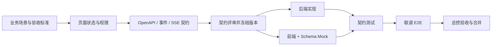
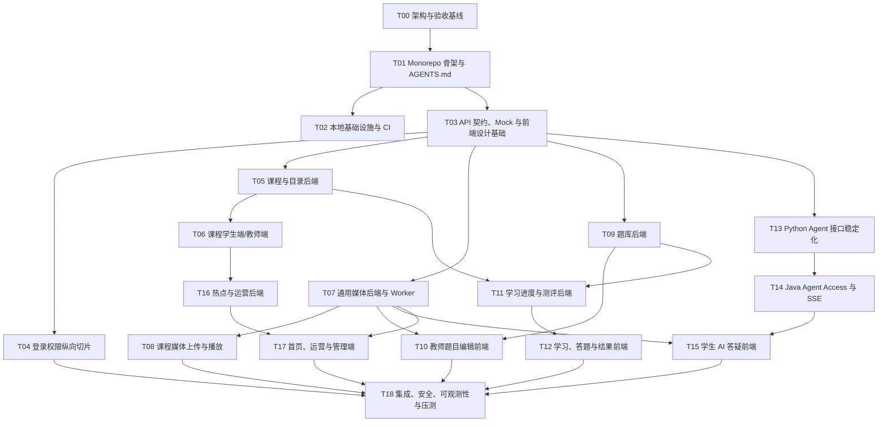

# 在线网课平台：Codex 实施与任务拆分指南

> 适用范围：Java 微服务、MySQL、Redis、Python 数学智能体，以及学生端、教师端、管理端三个 Vue 前端。

## 1. 结论：不要一个任务全做，也不要按类开几十个任务

推荐采用“一个总控任务 + 多个纵向功能任务 + 少量专项任务”的方式：

- **总控任务**维护架构、任务依赖、接口契约、集成状态和验收结果，不连续编写所有业务代码；
- **纵向功能任务**一次完成一个用户可验证的闭环，例如“教师上传视频并看到转码状态”，同时包含所需前端、API、服务、数据和测试；
- **专项任务**只处理不能自然放入纵向功能的基础设施，例如 CI、可观测性、压测和安全审计；
- 同时进行 2～4 个边界独立的任务即可。任务过多会增加契约冲突、重复实现和集成成本；
- 每个任务使用独立分支或 Worktree，合并前由总控任务核对契约、迁移、测试和文档。

不推荐两种极端：

1. **一个 Codex 任务实现整个平台**：上下文过大，容易跨模块做出未经确认的设计，最终难以审核和回滚。
2. **每个 Controller/页面/表单一个任务**：局部看似并行，实际会让 DTO、错误码、权限和交互状态各自演化，集成成本高于编码成本。

最合适的粒度通常是 1～5 个工作日可完成、能够独立演示、拥有明确验收标准的一条纵向切片。

## 2. 开工前建立唯一事实来源

先在仓库中固定以下文件，后续所有 Codex 任务都引用它们：

```text
AGENTS.md                         # 仓库规则、构建/测试命令、禁止事项
docs/architecture/system.md       # 总体架构和领域边界
docs/roadmap/backlog.md            # 任务编号、依赖、状态、负责人/任务链接
docs/api/*.yaml                    # OpenAPI 契约
docs/events/*.yaml                 # MQ 事件 Schema
docs/ai/sse-events.md              # AI SSE 事件与终止语义
docs/frontend/page-specs.md        # 路由、页面状态、权限和交互说明
docs/frontend/design-tokens.md     # 颜色、字号、间距、断点和组件约束
docs/adr/*.md                      # 重要架构决策记录
```

`AGENTS.md` 至少写明：

- 项目模块和所有权边界；
- Java、Python、前端的构建、Lint、测试命令；
- 数据库迁移、OpenAPI 生成和消息 Schema 校验方式；
- 不允许跨服务直接查表、不手写重复 DTO、不提交密钥、不绕过 Gateway；
- 变更完成标准和需要更新的文档；
- 工作区中已有改动的保护规则。

OpenAI 官方建议使用 `AGENTS.md` 告诉 Codex 如何导航仓库、运行测试并遵守项目约定；完成后仍应人工检查 diff、日志和测试结果：[Introducing Codex](https://openai.com/index/introducing-codex/)。

## 3. 前后端并行的前提：先冻结契约，再写实现

前端不能等待整个后端完成，但也不能凭页面原型猜接口。每个纵向功能按以下顺序执行：



契约至少包含：

- 请求、响应、分页、枚举、时间和金额格式；
- 401、403、404、409、422、429、5xx 的错误码和页面行为；
- 幂等键、版本号和重复提交语义；
- 权限与数据范围；
- 上传、转码、考试、AI 会话的状态机；
- SSE 事件类型、顺序、断线恢复、降级和终止条件；
- 示例数据，但示例不能替代 Schema。

契约冻结并非永不改变。若要修改，应先更新 Schema、兼容性说明和消费者，再修改实现；不要让某个任务偷偷改字段并要求其他任务追赶。

## 4. 推荐的仓库级任务依赖



## 5. 建议任务清单

| 编号 | 任务 | 主要交付物 | 可并行条件 |
|---|---|---|---|
| T00 | 架构与验收基线 | 架构文档、MVP 范围、SLO、ADR、任务图 | 第一个完成 |
| T01 | Monorepo 骨架 | Maven 多模块、Python 包、前端 Monorepo、`AGENTS.md` | T00 后 |
| T02 | 本地环境与 CI | 现有 MySQL/Redis、本地安全凭据、阿里云 OSS 配置占位、MQ 禁用降级和基础流水线 | T01 后，可与 T03 并行 |
| T03 | 契约与前端基础 | OpenAPI、Mock、错误协议、设计令牌、三端路由壳 | T01 后，可与 T02 并行 |
| T04 | 身份权限切片 | IAM、Gateway 登录、三端登录/路由守卫、权限测试 | T03 后 |
| T05 | 课程与目录后端 | 课程版本、目录、发布审核 API 和迁移 | T03 后 |
| T06 | 课程前端 | 学生列表/详情、教师课程编辑/目录编排 | T05 契约冻结后，可与实现后半段并行 |
| T07 | 通用媒体后端 | 阿里云 OSS 上传会话、用途策略、直传确认、扫描/派生、转码 Worker、短期访问授权和过期回收 | T03 后 |
| T08 | 课程媒体前端与绑定 | T06 封面 URL 收口、封面直传/预览/替换、视频分片续传、课件/字幕、资源绑定、转码状态和 HLS 播放 | T07 状态机冻结后 |
| T09 | 题库后端 | 题目版本、知识点、图片/音频/附件资产引用、批量导入任务与权限 API | T03 后；资产契约复用 T07 |
| T10 | 题库前端 | 教师题目编辑器、公式、图片/音频/附件直传、预览、导入源文件上传和结果 | T07、T09 契约冻结后 |
| T11 | 学习测评后端 | 报名、进度、试卷快照、作答、判分、错题 | T05、T09 后 |
| T12 | 学习测评前端 | 学习页、练习/考试、结果和错题本 | T11 契约冻结后 |
| T13 | Agent 接口稳定化 | 复用现有 Python 服务，固定请求、SSE、限额和降级 | T03 后 |
| T14 | Java Agent Access | 鉴权、上下文、AI 图片资产授权/短期转交、限流、审计、SSE 代理和故障降级 | T13 后；图片能力复用 T07 |
| T15 | AI 答疑前端 | 对话、公式、图片直传、教学反馈、终止/人工帮助状态 | T07、T14 契约冻结后 |
| T16 | 热点、运营与审核后端 | 行为事件、Redis 榜单、运营位、Banner/专题资产引用、教师审核材料和限期导出任务 | 课程主链路可用后；资产契约复用 T07 |
| T17 | 首页、资料、运营与管理端 | 学生首页、头像/资质/Banner 上传、管理端审核、运营配置和短期报表下载 | T07、T16 契约冻结后 |
| T18 | 发布前集成 | 全链路 E2E、全部占位资产收口审计、压测、安全、观测、OSS 生命周期和备份恢复、发布清单 | 主链路完成后 |

### 5.1 阶段性 URL/文件占位收口表

“页面上已经有 URL 字段”不等于上传功能已经完成，也不会在后续任务中自动变成 OSS。每个占位必须由明确任务修改契约、业务引用、页面交互和测试：

| 当前或预期占位 | 最终形态 | 负责收口任务 | 完成证据 |
|---|---|---|---|
| T06 教师手填 `coverUrl` | `COURSE_COVER` 直传 OSS，课程保存 `coverMediaId`，读取返回 CDN 展示 URL | T08 | 新 UI 无 URL 输入框；迁移兼容旧数据；替换/失败/孤儿清理测试 |
| T05/T06 `VIDEO` 仅目录类型 | 上传/转码就绪的 `LESSON_VIDEO` 资产绑定课时，学生短期授权播放 | T07 + T08 | 续传、转码失败、发布校验、授权过期和播放恢复 E2E |
| 图文课时仅标题/类型 | `COURSEWARE`/`ARTICLE_ATTACHMENT` 资产绑定并按课程权限下载 | T07 + T08 | 未授权下载 403、短期 URL 到期、替换与删除测试 |
| T04 `avatarUrl` 示例/外链 | `USER_AVATAR` 上传、裁剪/派生、审核后 CDN 展示 | T17 | 用户只能替换本人头像；历史 URL 兼容和默认头像测试 |
| 教师资质材料尚无文件闭环 | 私有 `TEACHER_QUALIFICATION`，管理员授权预览 | T16 + T17 | 非审核人员不可访问；审计、保留期和重新提交测试 |
| 题目仅规划图片/音频/附件 | 题目版本绑定稳定资产 ID | T09 + T10 | 题目版本快照不因资源替换改变；预览权限测试 |
| Excel/图片导入只描述流程 | 导入源文件直传 OSS，异步解析，源文件限期清理 | T09 + T10 | 导入幂等、逐行错误、恶意文件拒绝和到期清理测试 |
| AI 图片题只描述 `image_urls` | `AI_QUESTION_IMAGE` 直传，Java 鉴权后生成短期只读地址给 Python | T14 + T15 | 学生隔离、内容安全、短期保留、Python 不持有 OSS 密钥 |
| Banner/专题封面只描述页面 | 运营资产上传、草稿预览、审核/发布后 CDN 地址 | T16 + T17 | 定时上下线、回滚、未发布对象不可公开访问 |
| 报表“导出”只有按钮/任务 | Worker 生成 `REPORT_EXPORT`，授权用户限时下载并自动删除 | T16 + T17 | 越权拒绝、过期失效、重复生成幂等和清理测试 |

T07 只提供通用资产能力，不替各领域保存业务绑定。T08、T10、T15、T17 必须分别修改本领域 OpenAPI/事件和前端；T18 使用本表逐项检查，不允许以“以后再接 OSS”通过发布验收。资产 ID、访问等级、状态机和保留期以 [`docs/adr/0004-oss-media-asset-lifecycle.md`](docs/adr/0004-oss-media-asset-lifecycle.md) 为准。

前端不是最后单独“补页面”。T04、T06、T08、T10、T12、T15、T17 均与对应服务契约成对规划，并在每个里程碑产出可演示用户流程。

## 6. 第一阶段的实际并行方式

在可同时运行多个 Codex 任务时，建议只维持以下四条工作流：

| 工作流 | 负责范围 | 常见任务 |
|---|---|---|
| Java | Gateway 与领域服务 | T04、T05、T07、T09、T11、T14、T16 |
| 前端 | 三端应用与共享包 | T03、T04、T06、T08、T10、T12、T15、T17 |
| Python AI | 现有 Agent 接口和检索/教学策略 | T13，以及 T14 联调支持 |
| 平台与质量 | 环境、CI、可观测、契约和 E2E | T02、T03、T18 |

并行示例：

1. 总控先完成 T03 的课程 OpenAPI 和页面状态评审；
2. Java 任务实现课程服务；
3. 前端任务使用同一 OpenAPI 生成客户端和 Mock，实现课程详情及课程编辑；
4. 平台任务增加契约检查和测试数据；
5. Java 可运行后，单独开启联调任务执行 E2E，问题回到各自任务修复；
6. 总控检查 diff、迁移、契约兼容性和验收证据后合并。

不应并行修改的内容：

- 根 Maven 父工程、根包管理锁文件和全局 CI 主流程；
- 同一数据库迁移序列或同一张表；
- 尚未冻结的同一份 OpenAPI/事件 Schema；
- 共享设计令牌和基础权限模型；
- 同一核心页面或同一个跨服务状态机。

Codex App 支持并行任务、独立线程和内置 Worktree，适合让任务在隔离代码副本中工作，再集中检查结果：[Introducing the Codex app](https://openai.com/index/introducing-the-codex-app/)。隔离解决文件冲突，但不会自动解决接口和业务冲突，因此契约冻结与总控验收仍然必要。

## 7. 每个 Codex 实现任务的标准提示词

复制下面模板，替换括号内容：

```text
任务编号：[Txx]
目标：[一句话描述可演示结果]

先阅读：
- 根目录 AGENTS.md
- docs/architecture/system.md
- [本任务相关 OpenAPI / 事件 / 页面规格]

范围：
- [允许修改的模块和页面]
- [必须实现的 API、状态和交互]

非目标：
- [本次明确不做的能力]
- 不重构无关模块，不引入另一套框架，不提前实现后续任务。

契约：
- 严格遵守 [schema 路径与版本]；如契约不足，先报告差异并更新契约评审，不自行猜字段。

验收标准：
1. [Given/When/Then 用户场景]
2. [权限、异常、幂等或降级场景]
3. [性能或可观测要求]

验证：
- 运行 [构建命令]
- 运行 [单元/集成/契约/E2E 命令]
- 在最终答复列出改动文件、命令结果、未解决风险，不只说“已完成”。

禁止：
- 不提交密钥；不跨服务查表；不绕过 Gateway；不改无关文件；不删除用户已有改动。
```

这个模板允许 Codex 自主实现，但把边界、验收和禁止事项写死。不要只给“实现课程模块”这种没有页面、异常和测试定义的指令。

## 8. 前端任务的附加提示词

每个前端任务再补充：

```text
前端应用：[student-web / teacher-web / admin-web]
路由：[明确路由]
页面状态：loading、empty、success、partial-error、403、404、429、offline
响应式范围：[手机/平板/桌面]
权限：[角色和数据范围]
接口来源：[OpenAPI 文件和版本]
Mock：必须由同一 Schema 生成或校验，禁止维护另一套 DTO
交互验收：[上传续传/重复提交/断线重连/二次确认等]
质量：TypeScript 无错误、Lint、组件测试、关键 Playwright 测试、基本键盘可访问性
视觉：遵循 design tokens；未提供高保真稿时保持简洁一致，不自行扩展业务功能
```

前端完成标准不是“页面能打开”，而是：

- 正常和异常状态完整；
- 权限表现与后端一致；
- 网络请求、缓存失效、取消和重试有确定行为；
- 关键操作防重复并给出可理解反馈；
- 具备契约 Mock、组件测试和至少一条主链路 E2E；
- 浏览器控制台无未处理错误，页面刷新和深链接可工作。

## 9. 总控任务的职责和提示词

总控任务只做跨任务协调和验收，避免它同时成为最大的编码任务：

```text
你是本仓库的集成总控。先读取 AGENTS.md、架构、backlog、OpenAPI 和 ADR。
本轮只做：
1. 检查 Txx/Tyy 的依赖和契约是否一致；
2. 审核 diff 是否越界或重复实现；
3. 运行组合构建、契约测试和关键 E2E；
4. 将问题按所属任务列出，必要时做小范围集成修复；
5. 更新 backlog 状态与验收证据。
不要借集成之名重构全部模块，也不要修改未评审的业务规则。
```

总控需重点检查：

- OpenAPI 生成代码是否与服务实现一致；
- 数据库迁移是否冲突且可向前执行；
- 前端是否绕过 Gateway 或手写重复 DTO；
- 事件是否有版本、幂等键和消费者失败策略；
- Python SSE、Java 转发和前端状态机的终止语义是否一致；
- 新功能是否有权限、审计、指标和错误处理；
- 测试是否真正覆盖验收场景，而非只覆盖工具函数。

## 10. Worktree、分支与合并规则

- 一个任务对应一个分支/Worktree，例如 `feat/t08-video-web`；
- Worktree 创建前，从同一已验收基线分出，避免各任务基线不同；
- 每个任务只修改声明范围，公共契约变更先回到契约任务评审；
- 数据库迁移使用不会重复的版本号或时间戳，禁止改写已合并迁移；
- 先合并契约与生成代码，再合并服务和前端消费者；
- 合并顺序一般为：基础设施/契约 → 后端与前端 → 联调修复 → E2E；
- 合并后重新运行仓库级测试，不用各 Worktree 的单独通过代替集成验证；
- 遇到冲突时由拥有该文件的任务处理，不让另一个任务直接覆盖。

## 11. 里程碑，而不是“代码写了多少”

### M1：课程可学

教师登录 → 创建课程 → 上传封面/视频/课件到 OSS → 绑定目录 → 发布；学生发现课程 → 查看封面 → 获得授权播放/下载 → 记录进度。课程表单不再手填 OSS URL。

### M2：练习可闭环

教师上传题目图片/附件或导入文件并创建测评 → 学生作答 → 判分/解析 → 错题本和教师学情。

### M3：AI 可安全接入

学生从课时/题目发起文本或图片答疑 → Java 校验会话和图片资产 → Python 分步讲解 → 前端流式呈现 → 循环上限/非数学/故障可降级。

### M4：平台可运营

热点课程、OSS Banner/专题图、头像/教师资质、课程/教师审核、内容治理、限时报表下载、告警、压测和恢复演练完成。

每个里程碑都必须在接近生产的测试环境通过端到端演示，不能用“各模块单测通过”替代。

## 12. 当前阶段建议给 Codex 的下一条实现指令

T01～T06 已合并。下一步先完成 T07，不要让 T08、T10、T15、T17 各自发明上传接口：

```text
任务编号：T07
目标：实现可复用的阿里云 OSS 媒体后端，使后续课程封面/视频、题目附件、AI 图片和运营素材共享同一安全上传与访问基础。

先阅读：
- AGENTS.md
- 在线网课平台工业架构设计.md 的 5.4、6.5、7.1、10、11、18 节
- docs/adr/0002-local-infrastructure-and-object-storage.md
- docs/adr/0004-oss-media-asset-lifecycle.md
- docs/adr/0005-rabbitmq-messaging.md
- docs/api/openapi.yaml 与 docs/events/*

范围：
1. 先更新并冻结媒体 OpenAPI、事件、用途枚举和状态机；
2. media-service 实现上传会话、用途策略、对象 Key 生成、单对象/Multipart 直传授权、幂等完成确认、OSS 元数据复核、资产查询、短期访问授权、引用事件台账和过期回收；
3. 首个可验证用途至少覆盖 COURSE_COVER 与 LESSON_VIDEO，但通用表不得保存课程实体；
4. 使用 RabbitMQ + Spring AMQP 实现媒体异步处理边界，包含 Outbox、发布确认、有限重试、死信和按 eventId 幂等消费；删除 T02 的 RocketMQ 遗留占位，不保留第二套 MQ；
5. 没有明确授权的专用测试 Bucket 时使用 OSS 适配器 Mock 完成单元/集成测试，不读取真实 Bucket；
6. 没有 RabbitMQ/FFmpeg/真实转码环境时允许关闭外部适配器完成基础构建与 Mock 测试，但必须明确降级和未验收项，不得伪造真实发布、死信或转码成功；
7. 提供 docs/delivery/T07-media-backend.md，更新 backlog、verification、OpenAPI、事件和本地环境文档。

非目标：
- 本任务不修改 T06 课程页面，不提前实现 T08；
- 不把文件字节经 Gateway/Java 中转；
- 不引入 MinIO，不提交 AccessKey，不让领域服务直连 OSS；
- 不提前创建题库、AI、运营或 IAM 业务绑定表。

完成后只创建 T07 PR，待状态机和契约验收后再启动 T08/T10/T15/T17 的消费者工作。
```

T07 验收后优先实施 T08，以“教师选择封面文件和视频并完成课程发布，学生可看到封面并播放视频”为验收闭环；这一步才正式移除 T06 页面上的手工封面 URL 输入。
