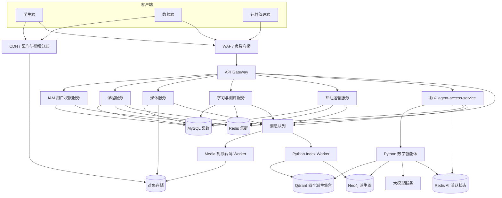
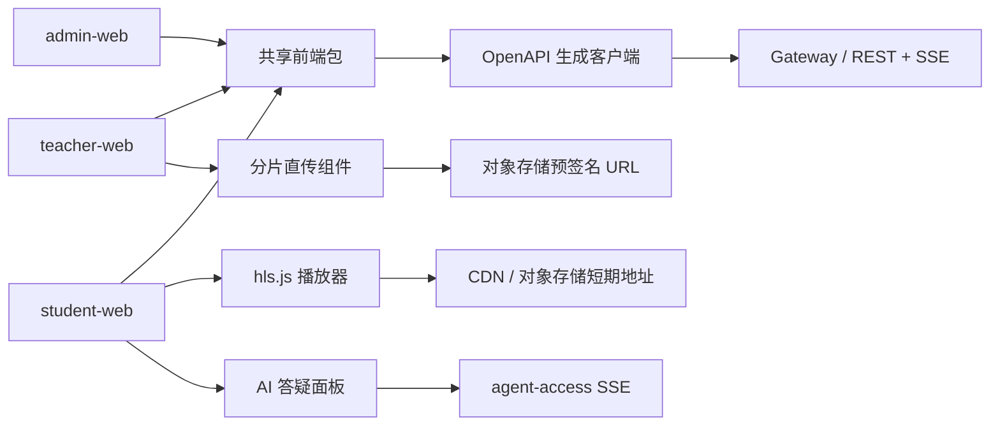
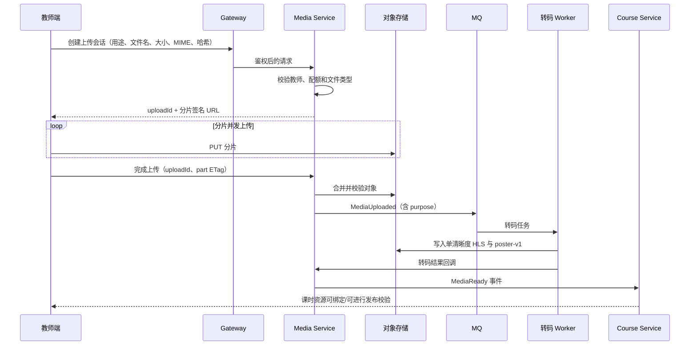
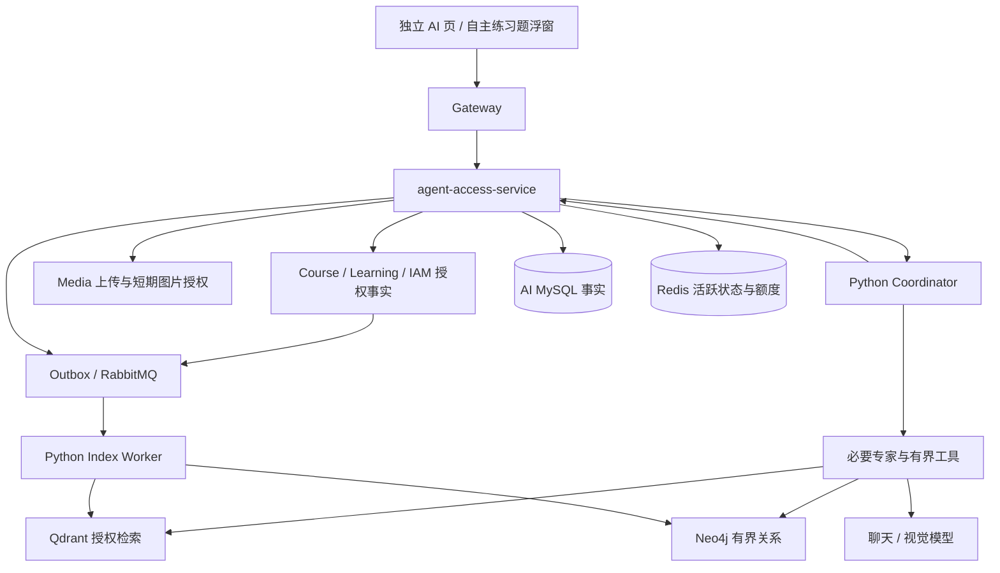

# 在线网课平台工业架构设计

> 文档状态：总体架构建议稿
> 目标读者：产品、架构、Java 后端、Python/AI、前端、测试、运维与安全人员
> 核心技术方向：Java 微服务 + MySQL + Redis + Python 个性化数学智能体

## 1. 建设目标

建设一个面向教师、学生和平台运营人员的在线网课平台，核心能力包括：

- 教师创建、编辑和发布课程；首期只审核教师资格，不设置课程审核关卡；
- 教师通过分片直传上传视频，平台完成转码、自动海报和安全处理；字幕只保留后续扩展边界；
- 教师创建题目、批量导入题目，并把题目绑定到课程、章节和测验；
- 学生选课、购买或领取课程，观看视频并记录学习进度；
- 学生完成随堂练习、章节测验和考试，查看成绩与解析；
- 接入初中数学个性化答疑智能体，结合课程、题库、知识点和学生学习记录进行分步辅导；
- 提供搜索、分类、标签、学习记录、热点课程、课程公告、站内消息和教师资格管理后台；收藏、评价、评论等互动后移；
- 满足可扩展、可观测、可审计、可降级和数据安全要求。

### 1.1 首期明确不做

为了控制复杂度，首期不建议同时建设以下能力：

- 自研实时直播音视频基础设施，可先接成熟云直播；
- 自研 DRM，可先使用对象存储/CDN 的鉴权、防盗链和动态水印；
- 复杂深度学习推荐系统，先做规则化热点和基础个性化排序；
- 多地域双活和跨云容灾；
- 将每个业务对象都拆成独立微服务；
- 让 AI 自动决定学生正式考试成绩或直接修改业务数据库。
- 课程收藏/评价/评论/点赞/举报、课程审核、Banner/专题和人工运营位、运营报表导出。

### 1.2 首期基础产品闭环

首期不能只完成课程、视频、题库、测评和 AI 的技术纵向切片，还必须覆盖公开网课平台的日常基础流程。下列能力属于首期完成标准，不得因为已有测试账号、演示数据或后台脚本而省略：

| 领域 | 首期必须具备的基础能力 | 边界 |
|---|---|---|
| 账号生命周期 | 学生通过已验证邮箱或手机号自主注册，支持密码/验证码登录、找回/重置/修改密码、身份绑定/换绑/解绑、当前设备和全部设备退出、基本资料与账号安全 | 昵称允许重名且不参与登录；管理员不允许公开注册；密码、验证码和完整 Token 不得写入 Redis 明文或日志 |
| 教师身份 | 普通账号申请教师、上传资质、查看审核状态、驳回后重新提交、审核通过后为同一账号增加教学能力；管理员可有审计地撤销/恢复教学能力 | 教师同时保留学习能力；首次授予必须审核通过；撤权须暂停本人已发布课程 |
| 课程发现 | 关键词、分类、难度和标签筛选、公开教师资料、六门 Redis 热点课程卡 | 首期可使用 MySQL 做普通搜索；首页热点只读 Redis 派生榜单，不以引入 Elasticsearch 为前提 |
| 课程学习 | 视频、图文和测评课时，目录、试看/锁定、当前播放器倍速、海报、断点续播、课件/附件授权、笔记和进度 | 课程详情只负责发现与决策，正式学习始终位于独立学习页；多码率/清晰度和字幕后移 |
| 学习管理 | 报名、取消免费课程报名、学习中/已完成/最近学习、继续学习、课程任务提醒 | 付费课程退出必须与退款规则联动，支付未实现前不伪造退款 |
| 作业测评 | 练习、作业和考试，开放/截止时间、迟交策略、作答次数、草稿、提交、批改、成绩册与导出 | 正式成绩、截止事实和作答记录以 MySQL 为准，不能只保存在浏览器或 Redis |
| 课程公告与消息 | owner 教师发课程公告，ACTIVE 学生在课程页确认；头像菜单消息页接收公告、开放作业/考试、教师审核结果和课程暂停/恢复 | Operation 拥有公告及投递/已读事实；Course/Learning/IAM 提供授权与可靠事件；普通消息不设统一 7 天 TTL |
| 平台管理 | 管理员教师资质审核、普通账号权限/封禁、管理员受控邀请、操作审计 | 管理员独立身份；危险操作显示影响、原因、二次确认，不能绕过首次教师审核 |
| 公共与合规页面 | 用户协议、隐私政策、账号注销/数据处理说明、帮助与反馈入口 | 具体合规文本和未成年人处理规则上线前需单独评审 |

首期范围和依赖以 [T16 已确认范围](docs/roadmap/T16-confirmed-scope.md) 为准。未来再启用收藏、评价或评论时，仍须另行进入版本化 OpenAPI、页面规格、backlog 和验收记录；这里只记录远期能力，不视为已交付。

## 2. 架构原则

1. **业务数据以 MySQL 为准**：Redis、搜索索引、热点榜单和向量库都不是业务事实源。
2. **业务文件不经过 Java 服务中转**：图片、小附件通过短期授权直传，视频和大文件通过短期签名 URL 分片直传对象存储，避免占满应用带宽和线程。
3. **服务拥有自己的数据**：禁止跨服务直接查询对方业务表，通过 API 或领域事件交换数据。
4. **先有限拆分，再按瓶颈演进**：首期控制在少量可独立部署单元，避免“分布式单体”。
5. **同步链路短、异步链路可重放**：转码、通知、统计、索引和热点计算使用消息队列。
6. **所有写操作可幂等**：上传完成、答题提交、支付回调、进度上报和消息消费均需要幂等键。
7. **AI 是受控能力，不是业务主库**：Java 平台负责身份、权限、课程、题目、答题和成绩，Python 只负责检索、推理和讲解。
8. **默认可降级**：AI、搜索、推荐、消息队列或转码暂时不可用时，不影响登录、课程浏览和已授权视频播放。

## 3. 推荐技术栈

| 层次 | 推荐技术 | 说明 |
|---|---|---|
| Web/管理端 | Vue 3 + TypeScript + Vite；播放器使用 hls.js | 学生端、教师端、运营端可共享组件库，路由和权限独立 |
| API 网关 | Spring Cloud Gateway | 统一鉴权、路由、限流、灰度、审计头和 Trace ID |
| Java 服务 | Java 21 LTS + Spring Boot；Spring Cloud 版本与 Boot Release Train 严格对齐 | 不建议随意混用不同代 Spring Cloud 组件 |
| 服务治理 | Nacos 注册/配置；Sentinel 限流、隔离和熔断 | 可替换为 Kubernetes 原生服务发现与配置，但首期只选一套主方案 |
| ORM/数据访问 | MyBatis/MyBatis-Plus + Flyway | 复杂统计 SQL 更可控；Flyway 管理数据库版本 |
| 主数据库 | MySQL InnoDB，按服务逻辑分库；生产主从/高可用 | 不允许把视频二进制写入 MySQL |
| 缓存与状态 | Redis Cluster 或云 Redis | 缓存、限流、验证码、短期锁定、会话版本、热点榜单、AI checkpoint；MySQL 保存 Refresh Session 和撤销审计事实，不默认把完整 JWT/用户会话复制进 Redis |
| 消息队列 | RabbitMQ 4.x + Spring AMQP | 承担转码、通知、统计和索引等跨服务事件；使用 Outbox、发布确认、有限重试、死信和幂等消费保证至少一次链路。T12G 播放心跳是 Learning 域内 Redis 缓冲，不再并行发送 RabbitMQ |
| 对象存储 | 阿里云 OSS；本项目不引入 MinIO | 原始视频、HLS 切片、封面、字幕、课件、题目/AI 图片、审核材料和导入导出文件 |
| 视频处理 | 云媒体处理优先；自建时使用 FFmpeg Worker | 转码、切片、截图、水印、字幕与内容审核 |
| CDN | 与对象存储配套的 CDN | 视频和图片走 CDN，API 不承担大流量内容分发 |
| 搜索 | 首期 MySQL 条件查询；数据量和搜索要求上升后接 Elasticsearch/OpenSearch | 课程、教师、题目和标签搜索；不是业务主库 |
| Python AI | Python 3.11/3.12 + FastAPI + LangGraph/LangChain | SSE 流式答疑、状态机、检索与模型编排 |
| 向量检索 | Qdrant：四个派生集合、BM25+dense/RRF、本地语义重排 | 停用旧 FAISS；共享 userId 过滤、分片/副本与有界重建；索引不作业务事实源 |
| 知识图谱 | Neo4j 派生知识图 | Java MySQL 为知识点/关系事实源，事件投影；图故障可降级，不存学生画像 |
| 可观测性 | OpenTelemetry + Prometheus + Grafana + 日志平台 | Java、Python、网关和异步任务统一 Trace ID |
| 部署 | 当前本地使用脚本启动现有服务；生产可演进到托管容器平台 | 本地不引入 Docker/MinIO，媒体 Worker 与 API 服务分别扩缩容 |

## 4. 总体逻辑架构



## 5. 首期部署单元与功能边界

首期建议采用同一代码仓库中的多模块工程，但每个服务可独立构建、部署和扩缩容。不要一开始拆成几十个仓库。

### 5.1 `gateway-service`：统一入口

职责：

- JWT/OAuth2 Token 校验和用户上下文透传；
- 路由、跨域、请求大小限制、IP/用户限流；
- 对视频签名、答题提交、AI 对话等接口设置不同限流策略；
- 生成或透传 `trace_id`、`request_id`、`tenant_id`；
- SSE 长连接转发和超时设置；
- 灰度发布、熔断和统一错误格式。

边界：

- 不保存课程和用户业务数据；
- 不执行复杂聚合查询；
- 不代理视频文件本身。

### 5.2 `iam-service`：身份、组织和权限

职责：

- 通过已验证邮箱/手机号注册、密码/验证码登录、登出、刷新 Token、找回密码；
- 学生、教师、运营人员身份；
- RBAC 角色权限和必要的 ABAC 数据范围；
- 教师资质审核、账号禁用、设备和登录审计；
- 学校/机构/班级能力，若首期没有机构业务可以先关闭。

拥有的数据：

- `user`、`user_identity`、`protocol_document`、`protocol_agreement`、`refresh_session`、`role`、`permission`、`user_role`；
- `teacher_profile`、`student_profile`；
- `organization`、`class_group`、`class_member`；
- `login_audit`、`account_risk_event`。

边界：

- 不保存课程详情和答题数据；
- 其他服务只保存 `user_id`，不复制完整用户资料。

身份与会话采用以下冻结边界：

- 邮箱、手机号是唯一且已验证的登录身份；昵称为 1～30 个可见字符、允许重名且只用于展示。新用户的兼容 `account` 由服务端生成内部技术值，正式与测试环境均不开放用户名登录。
- 首期手机号输入限定中国大陆 11 位并规范为 `+86` E.164；邮箱去除首尾空格并按不区分大小写的规范值唯一。每个账号最多一个已验证邮箱和一个已验证手机号，换绑先验证新身份再原子替换旧身份。
- 密码登录和一次性验证码登录共用角色中立入口。邮箱先实现供应商无关的标准 SMTP；手机在 local/test 使用固定码，生产只有配置并启用短信供应商后才由能力接口开放。
- Redis 保存算式验证码、一次性验证码、发送冷却、登录失败、短期锁定、Gateway 限流和当前会话版本。第 4～5 次密码尝试需要算式验证码，第 5 次仍失败后锁定 15 分钟；未知身份保持不可枚举响应与近似处理时序。
- Access JWT 固定 15 分钟且只保存在浏览器内存；7 天 Refresh Token 只存在 `HttpOnly` Cookie，数据库仅保存其摘要及 Refresh Session、设备、撤销和审计事实。所有实例可验证 JWT，Redis 只缓存安全版本和短期状态；不以完整 JWT 为 Key 保存用户资料，不为未证明的性能问题提前维护第二份完整 Session。
- 高风险的密码、身份或管理员变更通过持久 `sessionVersion` 和 Refresh Session 撤销实现即时失效。若未来压测证明刷新会话查询成为热点，可在保持 MySQL 事实源的前提下增加 Cache Aside 活跃会话缓存；不得先用 Redis 双写制造撤销一致性风险。
- 用户协议和隐私政策按不可变版本保存，公开当前正文、版本、生效时间和重新同意标记；注册只接受当前有效版本，历史同意不得覆盖。测试正文必须明确禁止正式发布。
- 自助账号注销不混入注册/登录补口；独立任务先冻结冷静期、恢复、教师/管理员影响以及课程、作答、成绩和审计数据保留规则。

### 5.3 `course-service`：课程、章节与发布

职责：

- 课程草稿、课程信息、教师归属、分类、标签和封面；
- 章节、课时、视频课时、图文课时、测验课时的编排；
- 课程版本和发布审核；
- 课程上下架、可见范围、免费/付费/班级专属规则；
- 课程目录查询和学生是否有学习权限的权威判断；
- 可选的课程价格 SKU，只保存商品定义，不直接承担支付回调。

拥有的数据：

- `course`、`course_version`、`course_teacher`；
- `chapter`、`lesson`、`lesson_resource`；
- `category`、`tag`、`course_tag`；
- `course_publish_review`、`course_access_policy`。

关键规则：

- 已发布版本不可直接原地修改，修改后生成新草稿版本；
- 学生学习记录引用具体的 `course_version_id` 和 `lesson_id`；
- 媒体服务只管理媒体资产，不决定课程是否可见。

### 5.4 `media-service`：上传、转码与播放授权

职责：

- 按资产用途创建单对象或分片上传会话并签发短期上传授权；
- 校验文件大小、类型、哈希、配额、所有者和用途权限；
- 确认上传完成并创建媒体资产；
- 对原始对象执行隔离、病毒/内容安全检查，并投递转码、截图、字幕、水印或文档处理任务；
- 接收媒体处理回调并维护资产状态；
- 为私有图片、附件、导入/导出文件和视频签发短期访问地址，为审核通过的公开图片生成版本化 CDN 投影；
- 查询校验/处理进度、失败原因、派生文件和可用清晰度；
- 回收过期上传会话、未绑定资产和超过保留期的临时文件。

拥有的数据：

- `media_asset`、`upload_session`、`upload_part`、`media_reference`；
- `processing_job`、`transcode_job`、`media_variant`、`subtitle_track`；
- `media_audit_record`、`access_grant_audit`、`playback_token_audit`。

边界：

- 对象存储保存文件，MySQL 只保存元数据和对象 Key；
- 客户端不得获得对象存储永久密钥；
- 业务服务保存稳定资产 ID，不保存 Bucket、Object Key 或短期签名 URL；
- 访问授权前调用所属领域服务或读取已同步的授权快照，媒体服务不自行判断课程、题目、AI 会话或审核记录可见性；
- 删除课程时不能立即物理删除共享媒体，应走引用计数和延迟回收。

#### 5.4.1 OSS 资产收口矩阵

当前契约中的 `coverUrl`、`avatarUrl` 等是阶段性展示字段。最终所有本地文件上传都复用 `media-service`，但业务引用和可见性仍由所属领域服务负责：

| 业务资产 | 业务引用服务 | 后续任务 |
|---|---|---|
| 课程封面、课时视频/海报/字幕、图文正文图片与课件 | `course-service` | T07/T08 提供上传、绑定和播放基础；T12F.1 增加内容/资源/自动海报契约，T12F.2 完成页面；字幕实现后移 |
| 题目图片/音频/附件、Excel 导入源文件 | `learning-service` | T09 定义题目/导入绑定，T10 完成上传、编辑和导入结果 |
| AI 提问图片 | Java Agent Access | T14 完成鉴权和短期转交，T15A/T15B 完成图片提问交互 |
| 用户头像、教师资质材料 | `iam-service` | T16.2 定义审核、引用和管理员短期预览；T17C.1 完成审核页面；头像资料仍按独立真实契约交付 |
| Banner、专题封面、报表导出 | `operation-service` | 仅保留未来媒体归属边界；不属于 T16/T17 首期交付，不能因枚举存在而启用上传 |

跨服务只交换 `mediaId` 和版本化事件，不建立跨 Schema 外键。公开图片只有在业务审核/发布后才可使用不可变 CDN 地址；其余对象默认私有并按请求签发短期地址。完整状态机、保留期和兼容迁移见 [ADR-0004](docs/adr/0004-oss-media-asset-lifecycle.md)。

### 5.5 `learning-service`：学习进度、题库、测评与成绩

首期把学习和测评放在同一服务，达到独立扩容或团队拆分条件后，再拆成 `learning-service`、`question-service` 和 `assessment-service`。

职责：

- 选课、报名、学习权限快照；
- 视频开始、暂停、心跳、完成度、最后播放位置；
- 学习记录、笔记和课程完成状态；
- 题目创建、编辑、版本管理、批量导入和标签；
- 题目绑定课程、章节、知识点和难度；
- 随堂练习、章节测验、考试试卷和答题会话；
- 客观题自动判分、主观题教师批改；
- 成绩、解析、错题本和薄弱知识点统计；
- 向智能体提供经过权限校验的题目快照和学习画像摘要。

拥有的数据：

- 学习：`enrollment`、`study_session`、`lesson_progress`、`playback_event`、`student_note`；
- 题库：`question`、`question_version`、`question_option`、`question_tag`、`question_knowledge_point`；
- 组卷：`paper`、`paper_question_snapshot`、`assessment`；
- 作答：`attempt`、`answer_record`、`grade_record`；
- 学习分析：`wrong_question`、`student_knowledge_profile`。

关键规则：

- 试卷必须保存题目版本快照，题库后续修改不能改变历史考试；
- `submit_attempt` 必须使用幂等键，禁止重复提交产生多份成绩；
- 正式成绩只能由确定性规则或教师确认产生，AI 建议不能直接落为正式分数；
- 播放心跳采用最终一致，不要每 5 秒直接同步写 MySQL。

### 5.6 `operation-service`：互动、热点与运营

职责：

- 首期课程公告版本、确认及站内消息投递/已读；
- 首页热点课程 Redis 派生榜单和可靠重建；
- 收藏/点赞/评价/评论/举报、首页人工运营位及内容治理仅是后续可能的职责，不属于首期实现；
- 平台业务指标的只读聚合，不直接修改其他服务业务表。

拥有的数据：

- `favorite`、`course_review`、`comment`、`comment_like`、`report`；
- `homepage_section`、`banner`、`topic`；
- `notification`、`notification_delivery`；
- `course_metric_daily`、`hot_course_snapshot`。

### 5.7 `agent-access-service`：独立 Java 智能体接入服务

2026-09-08 决策：独立部署与 Schema，不作为 learning-service 内部模块。完整设计与 Q1～Q91 对照见 [学生数学 Agent 重设计](docs/architecture/agent-platform-design.md)。本文为目标，T14 系列尚未实现。

- 拥有会话、消息、run、工具审计、摘要/长期记忆/证据/主题画像/偏好、用量与安全事件，后续拥有 pendingAction。
- 通过 IAM/Course/Learning API 获取可信全局 userId 和最小授权事实；只允许当前公布状态的成绩与题目数据，索引候选进入模型前核验当前可见性。
- 经 Media 绑定 AI 图片并获取短期读取授权，不接 OSS SDK，不保存签名 URL；学生本人会话首期不向教师开放。
- HTTP 流转发、同会话单轮、取消/部分消息/重生成、Redis 并发配额、运行预算和持久用量；普通恢复不启动新模型调用。
- MySQL 为记忆事实源，Redis 为活跃状态。Python 返回候选证据，由 Java 校验来源并聚合；画像不向学生公开，学生只修改讲解偏好。
- 后续自主组题 Skill 经明确确认才由 Java 调用 Learning 创建，Agent 不替学生作答、提交或判分。

### 5.8 `math-agent-service` 与 Python Index Worker

沿用 edu_agent_app 入口改造，LangGraph 负责可控动态编排，取消固定认知诊断/解题图及新架构对 FAISS/PostgreSQL checkpoint 的依赖。一个 Python 在线服务承载 Coordinator、Math Tutor、Practice Coach、Study Planner、Platform Help 五种角色，不为每个角色创建服务。

- 规则＋LLM 分层意图、槽位澄清、选择必要专家、按需工具与最多两个有序子请求；单专家可直接流式作答，不强制 Coordinator 再调模型改写。
- 题库/知识/主动课程文字按意图分路；Qdrant 四集合、BM25＋本地 bge-base-zh（768 维）融合、本地 bge-reranker-base 语义重排；阈值以实测确定。
- 图片经授权后使用多模态模型理解，识别不清先询问；只读 Neo4j 有界前置关系。索引/图故障提供明确降级，不冒充检索命中。
- 每轮默认 12 步、8 次 LLM（其中预留 1 次降级）、10 次工具尝试、2 次转交、同工具同参数 2 次、约 90 秒；同教学步骤最多三次补救，终止不转人工。
- 摘要/记忆提取独立有界预算且计入总用量，保留近期上下文与未解决任务；Python 永不读取 Java MySQL。
- 独立 Index Worker 消费 Java Outbox/RabbitMQ 事件，按版本幂等投影 Qdrant/Neo4j，有限重试/DLQ及有界重建；与在线模型资源隔离或错峰。
- 首期只服务学生初中数学及相关学习帮助；学习计划只输出文本，公共题自主组题与用户帮助知识库独立分期交付。
### 5.9 前端应用：学生端、教师端与管理端

前端采用一个 Monorepo、三个可独立构建和发布的应用：

- `student-web`：课程发现、视频学习、答题、学习记录和 AI 数学答疑；
- `teacher-web`：课程编排、视频上传、题库与测评、学生学习数据；
- `admin-web`：首期教师资格审核和账号权限管理；课程审核、内容治理、运营配置与平台报表后移；
- `packages/*`：设计令牌、基础组件、OpenAPI 生成客户端、通用类型和测试工具。

边界：

- 三端共享技术基础，不共享包含角色业务判断的“大而全”页面组件；
- 前端只负责交互和展示，权限、价格、课程访问和成绩以服务端判断为准；
- 首期不额外增加 BFF，页面聚合由 Gateway 后面的领域 API 提供；出现大量跨服务页面拼装和移动端差异后再评估 BFF；
- 浏览器不持有对象存储永久密钥，视频直传对象存储、播放使用短期授权地址；
- 前端不得直连 Python Agent，统一经过 `agent-access` 完成鉴权、限流和审计。

## 6. 前端应用架构与页面设计

本节给出总体目标，详细路由、页面职责、访问能力、状态和 Txx 归属以 [`docs/frontend/page-specs.md`](docs/frontend/page-specs.md) 为唯一事实来源。总体架构与页面规格发生冲突时必须由总控任务先统一文档，功能任务不得选择性采用。

### 6.1 技术与工程结构

推荐采用：Vue 3、TypeScript、Vite、Vue Router、Pinia、TanStack Query（Vue Query）、Element Plus、Axios 或原生 `fetch`、hls.js、Markdown 渲染和 KaTeX。教师端和管理端可重用后台组件，学生端保留独立视觉与移动端适配。

```text
web-apps/
  apps/
    student-web/
    teacher-web/
    admin-web/
  packages/
    api-client/            # 根据 OpenAPI 生成，禁止手写重复 DTO
    ui/                    # 无业务含义的基础组件
    design-tokens/         # 色彩、字号、间距和断点
    auth/                  # 登录态、路由守卫和权限指令
    types/                 # 仅放前端通用类型
    test-utils/
  e2e/
```



状态管理分层：

- 服务端状态（课程、目录、题目、进度、榜单）由 Vue Query 管理缓存、失效和重试；
- Pinia 只保存登录用户摘要、界面偏好、草稿步骤等客户端状态，避免复制整个服务端响应；
- 上传任务、视频播放和 AI 流式会话使用明确状态机，不用多个布尔值拼接隐含状态；
- API DTO 与错误码来自版本化 OpenAPI；前端不能为“先把页面做出来”而自行发明接口字段。

### 6.1.1 三端全局应用壳与导航

三端全局应用壳必须先于业务页面冻结。品牌区固定显示 `Edu Lion`，页面标题放入内容区；已启用主导航的标签、顺序和位置不随路由、登录状态动态变化。未交付入口不跳转到占位页。账号工具区固定承载工作台和登录/头像状态；“消息”只在头像菜单，头像显示未读角标，不再保留独立通知槽位。详细规则以 [`docs/frontend/page-specs.md`](docs/frontend/page-specs.md) 第 2.5～2.8 节为准。

学生端固定主导航依次为：首页、课程中心、我的学习、题库、AI 答疑。教师端固定主导航依次为：课程中心、工作台、课程管理、题库、测评管理、学情分析、媒体中心。管理端首期左侧栏固定为教师审核、账号权限，默认落点为教师审核；工作台摘要后移，课程审核、内容治理、人工运营位和报表不显示为可用入口。响应式只能折叠同一已启用入口集合，不能动态重排。

### 6.2 学生端信息架构

| 路由 | 页面 | 主要职责 |
|---|---|---|
| `/login` | 统一登录 | 角色中立登录、安全回跳、注册和找回密码入口 |
| `/register` | 学生注册 | 验证码、手机号/邮箱验证、设置密码和协议确认 |
| `/forgot-password`、`/reset-password` | 密码找回 | 一次性挑战、重置密码和全部旧会话失效 |
| `/` | 首页 | 分类、六门 Redis 热点公开课程卡与继续学习；不足时明确标“新课” |
| `/courses` | 课程列表 | 分类、关键词、标签、难度筛选和分页 |
| `/courses/:courseId` | 课程详情 | 简介、教师、目录、学习权限和报名入口；ACTIVE 已报名学生另读受保护公告区 |
| `/teachers/:teacherId` | 教师主页 | 审核通过的公开资料和已发布课程 |
| `/learn/:courseId/:lessonId` | 课程学习 | 视频/图文、目录、进度、笔记和本课时任务；不加 AI 入口 |
| `/my-learning` | 我的学习 | 学习中、已完成、最近学习和继续学习 |
| `/practice` | 顶部题库 | 无课程归属公共题目/自主练习；T10C.2 纠正当前测评列表 |
| `/practice/questions/:questionId` | 独立题目 | 安全题目与自主练习区域，T15B 加悬浮答疑 |
| `/learn/:courseId/tasks?type=PRACTICE` | 本课程练习 | 从具体课程详情“课程练习”进入，只展示本课教师发布的练习；契约由 T10C.1 补齐 |
| `/practice/:assessmentId` | 无课程自主练习 | 保留普通作答恢复；课程关联练习由 T10C 系列安全导向本课程路由 |
| `/attempt/:attemptId/result` | 答题结果 | 得分、解析、知识点、错题归档；按发布策略控制答案可见性 |
| `/wrong-questions` | 错题本 | 课程/知识点筛选、重做和掌握状态 |
| `/ai` | AI 答疑入口 | 最近会话、新建会话和能力说明 |
| `/ai/conversations/:conversationId` | 独立数学答疑 | 文本/图片、历史/分步讲解/来源/停止，无人工转交；独立会话无 30 分钟换新限制 |
| `/notifications` | 消息 | 从头像菜单进入，四类站内消息、已读状态和授权后目标跳转 |
| `/profile` | 个人资料 | 当前账号摘要、教师申请和账号安全入口；头像/资料编辑缺少完整写契约，归后续独立账号任务，不混入T17A |
| `/profile/security` | 账号安全 | 修改密码、绑定方式、当前会话和全部设备退出 |
| `/apply-teacher` | 教师申请 | 资质材料、申请状态、驳回原因和重新提交 |
| `/terms`、`/privacy`、`/help` | 公共与帮助 | 用户协议、隐私政策、数据处理说明和帮助反馈入口 |

课程学习页是学生端核心页面，应由以下区域组成：

- `VideoPlayer`：单清晰度 HLS、当前实例倍速、海报、断点续播和错误恢复；离开页面时销毁 hls.js 实例；多码率/字幕后移；
- `CourseOutline`：章节折叠、课时状态、试看/锁定提示；
- `ProgressTracker`：心跳批量上报、页面隐藏/退出补报、幂等事件编号；
- `LessonNotes`：按时间点记录笔记，可跳转播放位置；
- `PracticeEntry`：随堂练习入口和未完成提醒；
- AI 答疑仅在独立页面和普通自主练习悬浮窗提供，不嵌入课程学习页。

课程详情与课程学习是不可合并的产品边界：课程详情服务于课程发现、了解和学习决策，正式播放器和持续学习状态只存在于 `/learn/:courseId/:lessonId`。媒体切片可以先建立学习页的播放器、目录和课时导航，但不得为了提前演示把播放器嵌回课程详情；报名、进度、笔记和课时任务沿用学习路由；AI 独立页面与自主练习题悬浮窗单独交付，课程详情只提供本课程练习入口。

### 6.3 教师端信息架构

| 路由 | 页面 | 主要职责 |
|---|---|---|
| `/teacher/dashboard` | 教师工作台 | 待处理事项、课程数据、最近上传和学生问题 |
| `/teacher/courses` | 课程管理 | 草稿、已发布、已下架与系统暂停课程列表 |
| `/teacher/courses/:courseId/edit` | 课程编辑 | 基本信息、封面、访问规则、版本和发布操作 |
| `/teacher/courses/:courseId/curriculum` | 目录编排 | 章节/课时拖拽、资源绑定、试看设置和发布校验 |
| `/teacher/courses/:courseId/announcements` | 课程公告 | 本人已发布课程的纯文本公告、改版和撤回 |
| `/teacher/media` | 媒体中心 | 分片上传、断点续传、转码状态、字幕和失败重试 |
| `/teacher/questions` | 题库 | 创建、批量导入、筛选、版本、知识点和审核状态 |
| `/teacher/assessments` | 测评管理 | 组卷、规则、开放时间、答案发布和批改 |
| `/teacher/gradebook` | 成绩册 | 按课程/测评查看提交、缺交、待批和成绩并安全导出 |
| `/teacher/students` | 学情管理 | 当前内容进度、观看时长和各类任务成绩 |
| `/teacher/analytics` | 数据分析 | 观看、完课、作答与成绩统计，不伪造风险或转化指标 |
| `/teacher/profile` | 教师资料 | 基本资料、头像、资质材料和审核状态 |

课程编辑器采用“基本信息—目录—资源—测评—预览—发布”的可恢复步骤流，不设置课程审核关卡。已发布课程的编辑必须明确显示“正在编辑新版本”，避免教师误以为会立即覆盖线上内容。

题目编辑器至少支持题型选择、Markdown/富文本题干、LaTeX 数学公式、图片、选项、标准答案、解析、评分规则、难度、知识点标签和学生端预览。保存前做客户端格式校验，但最终校验和版本生成由服务端负责。

### 6.4 管理端信息架构

| 路由 | 页面 | 主要职责 |
|---|---|---|
| `/admin/dashboard` | 管理工作台 | 后移；首期默认进入教师审核，无真实摘要契约不启用 |
| `/admin/users` | 账号权限 | 普通账号合法能力组合、教师撤权/恢复、封禁、管理员邀请和审计 |
| `/admin/teacher-review` | 教师审核 | 资质短期预览/下载、审核决定与历史 |

课程审核、内容治理、人工运营配置、分类治理和平台报表后移，不作为首期可点击路由或空成功页。

管理端的危险操作必须二次确认、填写原因并展示影响范围；批量操作需返回逐项结果，不能只提示“操作成功”。

### 6.4.1 分阶段页面交付

页面结构必须先稳定，再按领域事实逐步填充；后续任务不得重复创建临时页面：

| 阶段任务 | 页面交付 |
|---|---|
| T08B | 教师课程媒体上传；课程详情学习入口；独立学习页的播放器、目录和课时导航 |
| T10 | 教师题库、题目编辑、附件上传、预览与导入结果 |
| T12A | 我的学习、报名后继续学习、学习进度和笔记 |
| T12B | 学生练习/结果/错题与教师测评管理 |
| T12C | 教师学情和教学分析 |
| T11C | 作业开放/截止、迟交、作答次数、教师成绩册和导出契约 |
| T12D | 账号注册、验证码、找回密码、会话安全、教师申请后端与 Redis 身份安全 |
| T12D.1 | 唯一邮箱/手机身份、协议版本、算式验证码、SMTP、验证码登录、渠道能力与身份绑定后端契约 |
| T12E | 只消费 T12D.1 契约交付统一登录/注册、密码找回、账号安全、教师申请、协议与静态帮助前端 |
| T12F.1 | 课程内容、资源动作授权、自动海报和图文完成后端契约；不实现 Vue |
| T12F.2 | 既有课程编排/学习页中的 Markdown 编辑渲染、正文图片、资料预览/下载、海报、倍速与完成反馈 |
| T12G.1 | 播放心跳 Redis 缓冲、强制 MySQL 检查点、可靠批量落库和读取合并后端契约 |
| T12G.2 | 既有播放器五类事件、有限重试、离页确认和进度同步状态前端 |
| T12H | 账号注销、冷静期、恢复、跨领域数据保留和审计契约 |
| T15A/T15B/T15C | 独立 AI 会话、普通自主练习跨题悬浮答疑、后续组题建议/确认卡；取消课程学习页内嵌 AI |
| T16.1～T16.4/T16A | 课程系统暂停与任务时钟顺延、教师审核、权限/邀请、课程公告和四类消息、Redis 热点派生 |
| T17A | 学生首页分类/热点/有界继续学习、课程公告区、三端头像菜单至唯一消息页和教师申请结果/真实能力刷新；头像资料编辑、正式协议重新同意及取消报名UI后移独立维护任务，不能当作本次已交付 |
| T17B.1 | 教师本人课程纯文本公告管理、发布/改版/撤回与审计分页；优先消费已有契约并与T17A学生公告/消息闭环，不扩工作台、媒体或资料 |
| T17B.2 | 教师工作台：先设计真实摘要/待办契约，既有固定导航保留建设中，不从零散分页推断总指标 |
| T17B.3 | 媒体中心：资产列表/单项上传已有；任务总览与引用位置存在缺口，先收缩范围或补投影契约，不列OSS或跨库查询 |
| T17B.4 | 教师与普通账号资料维护：先补昵称/头像mediaId写入、绑定释放契约；现有摘要/资质页不能冒充完整编辑能力 |
| T17C.1 | 管理端稳定应用壳、教师资格审核列表/详情、授权材料和决定历史；优先实施，不混入权限或邀请 |
| T17C.2 | 账号查询、合法能力组合、影响预览、撤权/恢复/封禁和协调状态；启动前独立复核契约 |
| T17C.3 | 账号权限区管理员邀请及统一身份壳受邀开户；复核 SMTP/邮件引导，无全量邀请列表契约不实现该表 |

没有真实契约和数据的页面不进入业务导航；`PlaceholderPage` 只能用于工程骨架，不能被交付文档或验收标记为业务功能完成。

上述任务边界已由总控同步到 `docs/frontend/page-specs.md`、`docs/roadmap/backlog.md` 和 `docs/roadmap/verification.md`。功能分支仍不得自行增加平行路由或猜测接口。

### 6.5 文件、媒体与 AI 交互约束

所有业务文件遵循“前端申请上传会话 → 浏览器直传 OSS → 前端确认完成 → 服务端校验/扫描/处理 → 领域绑定”的统一链路。课程封面、头像、Banner 和题目图片等小文件使用短期单对象直传；视频和较大文件使用分片上传。上传会话必须声明用途，不允许把 `COURSE_COVER` 资产绑定成教师资质或 AI 提问图片。

视频上传组件要支持暂停、续传、并发分片、哈希校验、刷新后恢复和失败分片重试；图片/附件组件要支持类型/大小预检、进度、取消、失败重试、预览和替换。任何文件二进制都不得经 Gateway 或 Java 领域服务中转，任何页面都不得要求用户复制 OSS Object Key 或永久签名 URL。

领域表单先上传并等待资产 `READY`，再提交稳定的 `mediaId`。替换资源时先绑定新资产，再异步释放旧引用；页面关闭或业务保存失败产生的未绑定资产由保留期任务清理。

播放器从媒体服务获取短期播放授权，再请求 CDN HLS 清单。对 401/403、授权过期和网络中断分别处理；禁止无限刷新签名或无限重试播放。首期只消费单清晰度 HLS，不展示不可用的清晰度或字幕控件。

#### 6.5.1 T12F 课程内容与资源授权冻结设计

T12F 按依赖拆为后端先行的 T12F.1 和前端后行的 T12F.2。T12F.1 计划把 OpenAPI 从 0.18.0 向前演进到 0.19.0，并新增 Course V4、Media V5 和 Learning V12；T12F.2 只能消费重新生成的客户端，不手写 DTO。两项都沿用既有课程编排和 `/learn/:courseId/:lessonId`，不复制页面或 OSS 客户端。

- 图文正文使用受控 Markdown，每课时最多 100,000 个可见字符，支持 LaTeX、标题、列表、表格、代码和 HTTPS 链接；禁止原始 HTML、脚本、iframe、危险协议、外部图片和 `data:`。教师实时预览与学生渲染使用同一套解析和消毒规则。
- 新用途 `ARTICLE_IMAGE` 只接受 JPG/JPEG、PNG、WebP，单图 10 MiB，正文以 `` 引用。引用集合与课程版本绑定必须一致；草稿可为空，但非法占位符、错用途、重复绑定和非 READY 资产立即拒绝，发布时正文必须非空且全部资源 READY。
- 课程版本保存资源的原始文件名、MIME、大小快照、1～120 字可选展示名和 `INLINE/DOWNLOAD` 呈现方式。PDF/普通图片可预览或下载，PPTX/TXT 只下载，正文图片只内联；首期不做 Office 在线转换。
- 公共课程详情只提供目录摘要，不提供正文、绑定或 `mediaId`。学生受保护内容接口校验登录、当前发布版本、报名或试看事实；浏览器按课程、课时、资源行和动作申请授权，由课程域解析真实媒体用途/变体/disposition 后调用 media-service。
- 新视频的单清晰度 HLS 与自动 `poster-v1` 都成功后才进入 READY。自动海报从前 30% 的非纯黑/纯白关键帧中有限选择，回退 10% 位置，输出不放大的最长边 1280 WebP；失败有限重试后标记处理失败。独立 `VIDEO_POSTER` 可覆盖自动海报。
- 历史 READY 视频不暗中批处理，也不增加生产重处理 API。少量本地开发视频只在 T12F.2 真实验收末尾通过正常授权、FFmpeg 截帧、正常上传/绑定和新版本发布补自定义海报；缺少自动海报时统一回退占位图。
- 倍速固定为 1 / 1.25 / 1.5 / 2 / 2.5 / 3，保持音调，只对当前播放器实例生效；切课、刷新或重新进入恢复 1x，不持久化。
- 图文正文成功渲染后调用 Learning 的独立幂等命令，把已报名学习者进度单调写为 100%。同一逻辑请求在页面存活期间最多有限重试三次，失败不阻止阅读且离页后不继续后台重试；未报名试看不写进度。
- 课时类型互转必须二次确认，并在保存事务中清除不兼容正文/绑定、写引用释放 Outbox；通用 `COURSEWARE` 可保留。取消确认必须完整保留原类型和未保存输入。
- 本轮明确不做多码率、清晰度选择、字幕访问/UI、历史海报重处理 API、DRM、AI 和 Redis 高频进度缓冲。既有 `SUBTITLE` 枚举、上传策略与 READY 校验继续保留为扩展边界，不删除已有安全能力。

AI 答疑使用结构化 SSE 事件，例如 `message.delta`、`step.completed`、`usage.updated`、`conversation.completed`、`conversation.degraded` 和 `error`。页面需支持：

- 流式状态、停止生成、断线重连和明确的最终状态；
- Markdown、公式、步骤卡片、引用题目/知识点和错误降级展示；
- 学生自然语言反馈、有限换讲法/例子/前置知识和明确终态；达到上限自动给有依据的简化答复，不转人工；
- 图片上传进度、内容安全失败和非数学问题提示；
- 不向学生展示模型内部推理、系统提示词或敏感检索元数据。

### 6.6 权限、安全与异常状态

- Access JWT 只保存在内存，长期 Refresh Token 只通过 `HttpOnly + Secure + SameSite` Cookie 持有；不写 `localStorage`，不把完整 JWT 或完整权限树复制进 Redis；
- Redis 负责验证码、失败次数、短期锁定、分布式限流和会话版本，MySQL 负责 Refresh Session、设备、撤销和安全审计事实。普通请求验证 JWT 而不是查询 MySQL Session；只有登录、刷新、退出和设备管理访问 Refresh Session；
- 路由守卫和按钮权限只是体验优化，所有写操作必须由后端再次鉴权；
- 三端均实现加载、空数据、部分失败、403、404、429、离线和系统错误状态；
- 富文本、Markdown、SVG 和外链内容必须消毒，防止 XSS；
- 日志和埋点不得包含密码、完整 Token、学生隐私、题目答案或永久媒体地址；
- 考试页面应处理刷新、重复提交、时间校准和多端冲突，但不能宣称浏览器侧防作弊绝对可靠。

### 6.7 性能、适配与可访问性

- 路由级懒加载，大型编辑器、播放器和图表按需加载；
- 长课程目录、题库和日志使用分页或虚拟列表；
- 静态资源通过 CDN 发布，图片生成多尺寸并使用现代格式；
- 学生端优先适配手机、平板和桌面，教师/管理端优先桌面并保证平板可操作；
- 关键操作支持键盘访问、可见焦点、表单标签、错误提示和合理色彩对比；
- 对课程详情、播放器首屏、提交答案和 AI 首字事件设置可观测的前端性能指标。

### 6.8 前端测试、发布与完成标准

测试分层：Vitest + Vue Test Utils 覆盖组件和状态逻辑，MSW 或契约 Mock 覆盖 API 场景，Playwright 覆盖登录、课程发布、视频学习、答题和 AI 答疑主链路。OpenAPI 变更必须执行兼容性检查和客户端重新生成。

每个前端任务完成需同时满足：

- 路由、权限、加载、空态、错误态和响应式布局完整；
- 不存在绕过 Gateway、直连 Python 或硬编码永久媒体地址；
- API 字段来自已确认契约，Mock 与真实接口使用同一 Schema；
- 核心交互具备组件测试，关键纵向链路具备 E2E 测试；
- 构建、类型检查、Lint 和测试通过；
- 关键按钮防重复提交，错误信息可操作，埋点和 Trace ID 可定位问题。

三个应用独立构建为静态资源并发布到 CDN/静态托管，按环境注入 Gateway 公共地址、Sentry/监控标识和功能开关。环境配置不得打包密钥。

## 7. 核心业务流程

### 7.1 教师课程媒体上传与发布

课程封面与视频使用同一上传会话模型，但处理策略不同：封面完成图片扫描、多尺寸派生后即可绑定草稿；T12F.1 后的新视频必须同时完成单清晰度 HLS、自动海报和审核后才可绑定为可发布课时资源。字幕不在本轮处理链路内。T08 完成后，教师端不再手工填写封面 URL。



推荐做法：

- 大文件采用分片上传、断点续传、并行上传和哈希校验；
- 上传 URL 有短有效期，并绑定对象 Key、教师和文件约束；
- 原始文件进入隔离前缀，审核/转码完成后才可发布；
- 首期生成既有单清晰度 HLS 和必需 `poster-v1`；多码率档位留到后续稳定运营阶段评审；
- CDN 回源只能访问已处理对象，原始视频默认私有；
- 转码任务状态采用 `PENDING/RUNNING/SUCCEEDED/FAILED/CANCELED`；
- Worker 消费必须幂等，同一个 `media_asset_id + preset_version` 不能重复生成脏数据。

### 7.2 学生观看和进度记录

1. 学生请求课时详情，课程服务校验报名、购买、班级和上下架状态。
2. 媒体服务签发短期播放 Token/URL，前端从 CDN 播放 HLS。
3. 前端在暂停、切课、主动离开和结束时发送强制检查点事件，播放期间最多每 5 秒合并发送一次普通心跳。
4. 网关只做限流；学习服务把显式 `HEARTBEAT` 原子合并到 Redis Hash，并用 dirty ZSet 标记待落库，不再为这一域内缓冲并行发送 MQ。
5. Learning 服务内的多实例定时 Worker 原子领取 dirty 项，正常情况下约每 5 秒批量 UPSERT MySQL；提交成功后仅在 Redis 版本未变化时清除 dirty 标记。
6. `PAUSE`、`LESSON_SWITCH`、`LEAVE`、`ENDED` 直接形成 MySQL 强制检查点；只有 `ENDED` 可请求完成。强制写成功后尽力校正 Redis，过期缓存不得回退 MySQL 新值。
7. 学生本人读取合并 Redis 与 MySQL；教师学情和报表只读 MySQL。Redis 故障时学生仍可读取最近持久化值，但普通心跳明确失败，不能伪装已保存。
8. `max_position`、有效观看时长和完成状态分别保存，不能只用最后一次上报位置判断完成；多设备保持最远位置单调，并按服务端时间窗口限制可累计观看秒数。

完成度建议：

- 视频观看完成度是学习参考，不等价于“已掌握”；
- 对可拖动视频，使用已观看时间区间合并，而不是仅依赖最大播放位置；
- 课程完成状态由课时完成规则汇总，可结合测验通过条件。

#### 7.2.1 T12G 可靠性冻结设计

T12G 按依赖拆为 T12G.1 后端契约和 T12G.2 前端接入。T12G.1 将 OpenAPI 向前演进到 0.20.0、Learning 数据迁移向前演进到 V13，并重新生成客户端；T12G.2 只消费该契约，不再修改服务端语义或复制播放器。

- 进度事件固定为 `HEARTBEAT`、`PAUSE`、`LESSON_SWITCH`、`LEAVE`、`ENDED`。`eventType` 在 0.20.0 保持可选：缺失时继续走原同步 MySQL 路径，以兼容旧页面、已打开标签页和回滚版本；不能根据时间间隔猜类型。只有 `ENDED` 可携带完成意图。
- 普通心跳只保留每个学习者、课程、课时的最新聚合值。Redis 使用 Hash 保存状态、dirty ZSet 保存待处理版本，Lua 保证合并和领取原子性；Learning 内部多实例 Worker 使用租约/版本领取，MySQL 提交后只清除未被新心跳更新的 dirty 项。
- MySQL 中的进度聚合、完成状态和强制检查点幂等事实是最终事实源，不保存每个 5 秒心跳的原始历史。强制检查点请求标识保留 30 天；聚合进度按账号与数据生命周期保留。Redis 中未落库 dirty 项不得因 TTL 或淘汰丢失，已落库热点值可以使用有界 TTL。
- 响应区分 `BUFFERED` 与 `PERSISTED`，学生读取在 Redis 降级时标记 `PERSISTED_ONLY`，并返回合并后的位置、完成状态和服务端接收时间。Redis 故障时普通心跳返回 503；暂停、切课、离开和结束仍直接尝试 MySQL，不以虚假成功掩盖故障。
- Worker 在 MySQL 故障时保留 dirty 项并有限退避，不设置 RabbitMQ DLQ。积压数量或最老年龄超过安全阈值后停止接收新的普通心跳并返回 503，防止继续扩大不可恢复窗口；MySQL 恢复后由同一 Worker 继续领取。
- 多设备不加播放锁，最远位置与完成状态保持单调。有效观看时长按服务端时间窗口限制累计量，不能把两个设备的相同时间简单相加；强制检查点的 MySQL 新值优先于 Redis 旧值。
- T12G.2 只在页面内存合并失败心跳并有限重试，不把未保存进度写入持久浏览器存储。强制检查点最多等待约 3 秒，失败时允许重试或明确选择仍然离开；标签关闭、刷新、浏览器崩溃只能尽力提交，不能承诺必达。
- Micrometer/Actuator 至少暴露心跳与强制检查点成功/失败、dirty 数量/最老年龄、批次领取/成功/失败/版本冲突、Redis/MySQL 降级、响应状态和 Worker 健康；不得记录 Token、完整 Redis 值或个人隐私。
- 首期容量目标为 1,000 个模拟学习者、约 200 次心跳请求/秒、连续至少 10 分钟，普通心跳 p95 小于 200ms，正常最老未落库年龄不超过约 5 秒。负载只打进度 API，不并发拉取 1,000 路视频。

### 7.3 题目上传和答题

支持题型：

- 单选、多选、判断；
- 填空；
- 解答题/证明题；
- 组合题及其子题。

题目内容模型应支持：

- Markdown/富文本；
- LaTeX 公式；
- 图片、音频和附件对象 Key；
- 标准答案、解析、评分规则；
- 教材版本、年级、难度、知识点和来源；
- 题目状态、版本、创建人、审核人和版权信息。

教师上传方式：

- 表单逐题创建；
- Excel/模板批量导入；
- 图片/OCR 辅助录入，但必须人工确认；
- 从个人题库复制到课程题库，复制后保持来源关系。

答题边界：

- 开始测验时生成 `attempt` 和试题快照；
- 客观题服务器判分，前端判分结果不可作为成绩；
- 主观题可由 AI 提供批改建议，但正式分数由教师确认；
- 每个答案保存题目版本、作答内容、耗时、提交次数和评分来源；
- 防作弊要求较高时再加入人脸、切屏、摄像头或远程监考，不与首期基础答题耦合。

### 7.4 个性化数学答疑

详细设计、数据模型和访谈追溯以 [Agent 重设计](docs/architecture/agent-platform-design.md) 为准，页面信息架构以 page-specs 为准。2026-09-08 本节替换旧固定检索/诊断流程；实际代码尚待 T13/T14 实施。



- HTTP 端到端流式转发、连接复用、有界缓冲；阶段事件与用户内容分开，内部推理/提示词/完整工具数据不返回。
- 请求绑定服务端可信 userId、messageId/runId 和逐消息资源版本；公共可信上下文与 Python 私有运行状态分层。外部 REST 以 OpenAPI 为准，内部协议由 T13.1 单独定义。
- 当前表达优先、默认分步；画像使用真实作答、已公布成绩和相关主题证据，模型不能制造精确能力百分比。仅提供文本学习建议。
- 原始消息默认 180 天可配置；活跃记忆有类型衰减，历史掌握证据不因时间自动变为未掌握，当前状态可被新证据修正。无学生画像展示/手动忘记入口。
- 悬浮窗跨题继续会话，30 分钟空闲才自动换新，输入和历史提供折叠题目卡；切题不中断当前生成，关闭才取消。独立页历史不受此期限限制。
- 读课程文字仅在学生明确询问且 Java 授权后执行；没有可读材料就说明看不到视频。AI 不改变练习提交或评分，后续组题 Skill 另需明确确认。
- 数据源事件和索引同步失败使用有界重试与可重建投影；空检索不是非数学判据，源数据不可见不得用缓存或图索引绕过。
## 8. 热点课程与基础推荐

### 8.1 事件来源

首期热点只消费 Course/Learning 已确认的公开发布、当前有效报名和去重学习事实；具体事件名称、版本和载荷须在 T16A 先评审 `docs/events/*`，这里不预先声称下列概念已存在于代码。收藏、评价、举报、曝光点击和原始观看秒数都不是首期排名信号。

### 8.2 热点计算

首期榜单按最近 7 天去重学习人数为主、有效报名人数为辅助排序。不得以重复播放的秒数刷榜，也不得引用首期未实现的收藏/评价/举报。数据不足时用近期发布的公开课程补位，但必须标“新课”，不伪称热门。

落地方式：

- Course/Learning 的 MySQL 事实经可靠事件形成可重建投影，Redis 保存首页排序结果；去重主体和有效报名定义在 T16A 契约中明确。
- 首页只读 Redis 派生榜单；Redis 不可用时仅热点区显示暂不可用，不在首页请求中同步扫库或回退大查询。普通课程搜索/列表继续可用。
- 不向用户展示不透明热度分；公共卡片展示封面、课程名、教师和清楚的学习信息，默认六门。

### 8.3 推荐演进

1. 第一阶段：已确认的热点与明确标为“新课”的近期课程；无人工运营位。
2. 第二阶段：依据学生年级、已学课程、薄弱知识点和协同统计做召回。
3. 第三阶段：多路召回、学习排序、探索比例和推荐解释。

推荐结果只影响展示，不改变课程权限和价格。

## 9. 数据与一致性设计

### 9.1 MySQL 使用边界

- 首期可共用一个高可用 MySQL 集群，但每个服务使用独立 Schema 和独立账号；
- 禁止跨 Schema 外键和跨服务 Join；
- 主键采用雪花 ID、UUIDv7 或数据库无关的有序 ID；
- 所有核心表包含 `created_at`、`updated_at`、`version` 和必要的软删除/状态字段；
- 金额使用最小货币单位整数，分数使用明确精度的 Decimal；
- 题目、课程和评分规则采用版本表或不可变快照。

### 9.2 Redis 使用边界

推荐用途：

- Gateway 按用户、IP、设备和接口执行多实例共享限流，覆盖登录、上传、导入、答题提交和 AI 请求；
- 登录失败计数、短期账号锁定、验证码、发送冷却和账号会话版本缓存；Refresh Session 和账号状态仍以 MySQL 为准；
- 课程分类、已发布课程详情、公开教师资料和高频列表页可按独立压测证据采用 Cache Aside 缓存；首页不设人工运营位；
- 播放心跳和最新位置使用 Redis Hash 高频暂存，以 dirty ZSet 标记待落库，并由 Learning 服务内 Worker 通过 Lua 原子领取、版本校验和批量 UPSERT 合并到 MySQL；本链路不使用 Redis Stream、RabbitMQ 或 DLQ；
- 暂停、切课、主动离开和播放结束直接写 MySQL 强制检查点；Redis 只提供低延迟缓冲和学生本人实时读取，教师学情、报表、完成事实和最终聚合仍以 MySQL 为准；
- 热点课程 Sorted Set、通知未读计数和可重建的首页推荐投影；
- 已由数据库事务成功完成的短期幂等响应复用；数据库唯一约束和事务仍是最终并发保证；
- 缓存重建、定时聚合等非核心协调任务的短期分布式锁；课程名额、交卷、成绩发布等核心写入不得只依赖 Redis 锁；
- AI checkpoint、语义缓存、每用户额度、并发会话数和单会话模型调用预算。

禁止用途：

- 把 Redis 当作唯一成绩库；
- 把购买权限只保存在 Redis；
- 把答案草稿、正式提交、成绩、课程发布状态或账号唯一性只保存在 Redis；
- 使用无 TTL 的用户级缓存无限增长；
- 用一个大锁包住长时间视频转码或 LLM 请求。

缓存策略：

- Cache Aside；
- 写 MySQL 成功后删除缓存，并通过领域事件处理跨服务缓存；
- 空结果短 TTL 防止缓存穿透；
- 热点 Key 增加随机过期抖动；
- 大规模失效前预热，防止缓存雪崩。

本地环境可以复用单个 Redis 并按逻辑 DB 隔离。生产环境至少应把“身份安全/限流状态”和“可淘汰业务缓存”分为不同实例或资源池，避免热点缓存淘汰登录锁定、会话版本和配额数据。Redis 故障时，公共内容缓存允许回源 MySQL 并配合并发保护；登录、验证码、上传、AI 等有滥用风险的写入口采用保守拒绝或明确降级，不得静默取消安全限制。

T12G 的播放进度缓冲属于不可随意淘汰的待持久化状态，应与可淘汰页面缓存隔离资源池。生产 Redis 至少启用 AOF `everysec` 和 `noeviction`，并对内存、dirty 数量及最老年龄告警；这些措施缩短故障窗口但不改变 MySQL 的最终事实地位。普通心跳逻辑请求的短期去重信息建议保留约 24 小时，未落库项在确认 MySQL 成功前不得过期。

### 9.3 跨服务一致性

不使用全局分布式事务作为默认方案，采用：

- 本地事务 + Outbox 事件表；
- 消费者幂等表或唯一业务键；
- 至少一次投递，业务侧去重；
- 失败重试、死信队列和人工补偿；
- 事件包含 `event_id`、`event_type`、`aggregate_id`、`version`、`occurred_at`、`trace_id`。

典型事件：

- `CoursePublished`、`CourseUnpublished`；
- `MediaUploaded`、`MediaReady`、`MediaFailed`；
- `EnrollmentCreated`；
- `LessonProgressChanged`；
- `AttemptSubmitted`、`GradeConfirmed`；
- `QuestionVersionPublished`；
- `AiConversationCompleted`。

## 10. API 与权限边界

### 10.1 外部 API 示例

```text
POST   /api/v1/auth/login
GET    /api/v1/courses
GET    /api/v1/courses/{courseId}
POST   /api/v1/teacher/courses
POST   /api/v1/media/uploads
POST   /api/v1/media/uploads/{uploadId}/complete
GET    /api/v1/media/{mediaId}
POST   /api/v1/media/{mediaId}/access-grants
GET    /api/v1/media/{mediaId}/playback-token
POST   /api/v1/questions/imports
POST   /api/v1/assessments/{assessmentId}/attempts
PUT    /api/v1/attempts/{attemptId}/answers/{questionId}
POST   /api/v1/attempts/{attemptId}/submit
PUT    /api/v1/lessons/{lessonId}/progress
POST   /api/v1/ai/conversations
POST   /api/v1/ai/conversations/{conversationId}/messages
```

### 10.2 权限模型

- 学生：只能访问已公开且自己有权限的课程、自己的答题和 AI 会话；
- 教师：只能维护本人或被授权协作的课程和题目；
- 机构管理员：只能访问机构数据；
- 平台运营：按岗位拥有审核、配置、客服或风控权限；
- 超级管理员：高风险操作需要二次认证和完整审计。

每个请求至少携带：

- `user_id`；
- `role/scopes`；
- `tenant_id`，如果启用多租户；
- `trace_id`；
- 客户端和设备风险信息。

前端隐藏按钮不等于权限控制，资源所有权必须在服务端校验。

## 11. 安全、隐私与内容治理

### 11.1 平台安全

- API 网关按用户、IP、设备、接口和租户执行 Redis 令牌桶/滑动窗口限流；
- 登录、支付、上传、答题提交和 AI 接口使用不同的风险策略；
- 密钥放入 Secret Manager/Kubernetes Secret，不写代码和镜像；
- 上传校验 MIME、扩展名、大小、哈希，并进行病毒和违规内容扫描；
- 视频播放使用短期签名、防盗链、Referer/UA 策略和可选动态水印；
- 防止越权访问、ID 枚举、SQL 注入、XSS、CSRF、SSRF 和恶意文件解析；
- 重要操作写不可抵赖审计日志；
- 数据库、对象存储和备份均加密，生产网络最小权限访问。

### 11.2 未成年人数据

- 遵循适用地区对未成年人个人信息和教育数据的要求；
- 只收集实现教学所需的最少数据；
- 明确监护人同意、数据导出、删除和保留期限；
- AI 对话、错题、学习画像属于敏感教育数据，严格限制访问；
- 日志和可观测系统不得记录 Token、密码、完整身份证件和无脱敏对话。

### 11.3 AI 安全

- Java 服务生成可信上下文，不能把客户端声称的角色直接传给模型；
- 对检索内容执行课程权限和租户过滤；
- 防止题目文本中的提示词注入改变系统规则；
- 工具调用采用白名单和最小权限，Python 不持有业务数据库写权限；
- 对自伤、暴力、色情、隐私和作弊请求设置安全路由；
- 对数学答案保留“AI 生成、需核验”标记；
- 保存 prompt/model/retrieval 版本，支持问题复现和回归评测。

## 12. 可观测性与稳定性

### 12.1 技术指标

- 网关和各服务 QPS、P50/P95/P99 延迟、错误率；
- MySQL 慢查询、连接池、复制延迟和锁等待；
- Redis 命中率、内存、热点 Key、淘汰和延迟；
- MQ 积压、消费延迟、重试和死信；
- 上传成功率、转码耗时、失败率和 CDN 命中率；
- AI 首 Token 延迟、完整耗时、模型错误率、检索命中率、Token 成本、预算耗尽/取消/降级率与索引滞后。

### 12.2 业务指标

- 注册、选课、付费和退款转化；
- 视频有效播放、完成率、学习时长；
- 练习参与率、提交率、正确率和知识点掌握变化；
- AI 答疑完成率、学生满意率、重复讲解次数和错误反馈率；
- 课程评价、举报率和教师内容通过率。

### 12.3 建议 SLO

| 能力 | 首期建议目标 |
|---|---|
| 登录、课程详情、学习记录 API | 月可用性 99.9% |
| 视频播放授权 API | 月可用性 99.95% |
| 普通 API P95 | 小于 300ms，不含第三方调用 |
| AI 首个可见响应 P95 | 小于 5s，模型供应商异常时允许降级 |
| 答题提交 | 幂等且不可丢，返回后最终成绩可追踪 |
| 进度上报 | 允许分钟级最终一致，不阻塞视频播放 |
| 转码任务 | 可重试、可查询、可人工重新投递 |

Java、Python、网关和 Worker 应使用 OpenTelemetry 传播同一个 Trace Context，并让日志包含 `trace_id` 和 `span_id`。

## 13. 部署与容量设计

### 13.1 环境

- `local`：复用开发机现有 MySQL/Redis，以脚本安全加载本地凭据；OSS 和 RabbitMQ 未显式配置时保持禁用，可使用测试模型；
- `test`：共享测试集群，自动初始化脱敏数据；
- `staging`：与生产拓扑相近，用于压力、回归和灰度验证；
- `production`：高可用 MySQL、Redis、MQ、对象存储、CDN 和多副本服务。

### 13.2 Kubernetes 建议

- Gateway、Java 服务、Python Agent、转码 Worker 分别部署；
- API 服务按 CPU/QPS 扩容，AI 服务按并发/Token 延迟扩容，转码 Worker 按队列积压扩容；
- 设置 readiness/liveness/startup probes；
- 设置 requests/limits、PodDisruptionBudget 和反亲和性；
- 使用滚动、蓝绿或金丝雀发布；
- 数据库、Redis、MQ 和对象存储优先使用成熟托管服务，除非团队具备运维能力。

### 13.3 关键容量原则

- 视频流量应主要落在 CDN，对应用服务器并发影响很小；
- 课程详情与首页是读多写少，优先缓存和 CDN 静态化；
- 播放心跳和曝光事件不得逐条同步写 MySQL；
- AI 并发需要按模型供应商限额、GPU/Token 吞吐和成本单独控制；
- 压测必须区分 API 请求、SSE 长连接、上传、转码和视频播放，不用单一 QPS 代表系统容量。

## 14. 故障与降级策略

| 故障 | 降级行为 |
|---|---|
| Redis 故障 | 普通课程查询继续使用领域 MySQL；首页热点区独立暂不可用，不同步扫描 MySQL 重算；后台受控重建 Redis 派生榜单；禁止依赖 Redis 生成正式成绩 |
| MQ 积压 | 上传完成可查询为“处理中”；进度和统计延迟，不阻塞播放与答题 |
| 转码失败 | 保留原始资产，支持人工重试和更换预设，不发布不可播放课时 |
| 搜索不可用 | 回退 MySQL 分类、标题和标签查询 |
| AI 服务不可用 | 返回普通题目解析/教师答疑入口，不影响答题提交和成绩 |
| LLM 超时或限额 | 中止当前生成、保留会话状态、提示稍后重试；不无限重试 |
| Neo4j 不可用 | 使用直接知识点结果，跳过前置关系个性化 |
| CDN 回源异常 | 多源站或云厂商容灾；已缓存内容继续服务 |
| MySQL 主库故障 | 高可用切换；写接口短时保护，避免客户端盲目重复提交 |

## 15. 代码仓库建议

```text
online-course-platform/
  java-platform/
    gateway-service/
    iam-service/
    course-service/
    media-service/
    learning-service/
    operation-service/
    shared-kernel/          # 只放技术基础，不放跨域业务实体
  python-agent/
    edu_agent_app/
    tests/
  web-apps/
    apps/
      student-web/
      teacher-web/
      admin-web/
    packages/
      api-client/
      ui/
      design-tokens/
      auth/
      test-utils/
    e2e/
  deploy/
    docker-compose/
    kubernetes/
    observability/
  docs/
    architecture/
    api/
    adr/                    # 架构决策记录
```

共享库边界：

- 可以共享错误码协议、Trace、鉴权 SDK、消息信封和基础测试工具；
- 不共享 JPA/MyBatis 业务实体；
- 不让多个服务引用同一套 Mapper；
- OpenAPI/事件 Schema 版本化并执行兼容性检查。

## 16. 分阶段落地路线

### 阶段一：可用闭环

- IAM、课程、媒体、学习测评、运营、Gateway 和 Python Agent；
- 学生端、教师端基础应用、共享设计系统和 OpenAPI 生成客户端；
- 学生自主注册、验证码、找回/修改密码、账号安全、教师申请和管理员用户管理；
- 教师创建课程，完成封面/视频直传 OSS 与视频转码，并创建含图片的题目；
- 学生选课、取消免费课程报名、观看视频/图文、下载课件、记录进度、答题和复习错题；
- owner 教师发布课程公告、学生确认及四类站内消息；管理员审核教师资格并管理合法账号权限；
- 教师撤权/封禁后自动暂停本人已发布课程，暂停期停止课程任务结算，恢复时按实际暂停时长顺延未结束任务；
- 作业开放/截止、迟交与作答次数规则，以及教师成绩册；
- 登录、课程编辑、视频上传、课程学习、练习结果和 AI 答疑页面形成可用闭环；
- 基础热点课程；
- Redis 分布式限流、身份安全、热点缓存、门户缓存和播放进度缓冲形成真实业务闭环；
- AI 文本题答疑和会话限制；
- 本地脚本化开发环境、前后端基础 CI/CD、契约测试和监控；首期不要求 Docker/MinIO。

验收标准：新学生无需预置数据库账号即可完成注册、登录、报名、学习视频/图文、下载授权课件、提交作业、查看允许公布的结果并发起数学答疑；普通用户可申请教师，管理员可审核并授予教学能力、随后依规则撤销/恢复；撤权时课程访问、旧作答深链和任务时钟安全收口。教师无需手填 OSS URL 即可上传封面、视频、自动/自定义海报、图文图片和课件并发布课程。公告及站内消息前后端闭环、Redis 热榜故障隔离、进度落库可独立验收。字幕、多码率、收藏与评价不属于首期验收。

### 阶段二：稳定运营

- 课程审核、举报、评价、收藏、评论与更复杂的内容互动；教师数据看板已有基础则继续增强；
- 管理端高级治理、教师深度分析和学生学习中心增强；
- 视频多码率、字幕、内容安全、CDN 鉴权；
- 题目批量导入、题目版本和正式考试；
- 三端 E2E 回归、前端性能监控、可访问性和弱网恢复；
- 搜索引擎、Outbox、死信补偿；
- AI 图片题、头像/教师资质、运营图片、限期报表下载、多级知识检索和学生知识画像；
- 全链路追踪、容量压测、备份恢复演练。

### 阶段三：规模化与商业化

- 订单、支付、退款、优惠、结算和发票服务；
- 机构、班级、作业、教师协作；
- 个性化推荐、实验平台和内容质量评分；
- 多租户隔离、更细粒度权限和数据治理；
- 多地域容灾、成本治理和模型路由。

## 17. 何时进一步拆分服务

只有满足以下条件之一才建议拆分：

- 模块需要独立扩缩容，例如媒体转码、搜索、考试或 AI；
- 发布频率和故障域明显不同；
- 数据边界已经稳定，并有独立团队负责；
- 单服务构建、测试和发布已经成为团队瓶颈；
- 合规要求需要独立网络或数据隔离。

不应因为“表很多”“类很多”或“微服务更先进”而拆分。首期 `learning-service` 同时承担学习与测评是有意设计；当考试并发、题库团队或评分流程独立后再拆。

## 18. 上线前验收清单

- [ ] 新用户可自主注册、验证身份、找回/修改密码；修改密码、禁用账号或管理员强制下线后旧会话按规则失效；
- [ ] 普通用户可申请教师并查看状态，审核通过后同一账号同时保留学习能力并获得教学能力；管理员账号不可公开注册；
- [ ] 用户协议、隐私政策、数据处理说明和帮助入口可访问，注册时保存版本化同意事实；
- [ ] 学生可取消免费课程报名、查看最近学习；课程收藏与评价不属于首期验收；
- [ ] 视频、图文、测评、自动/自定义海报、课件和附件均有明确的教师绑定与学生授权访问闭环；字幕保留安全绑定边界但不作为首期页面能力；
- [ ] HOMEWORK 支持开放/截止、迟交和作答次数策略，教师成绩册可区分缺交、已交、待批和已批；
- [ ] 管理员可在真实后台审核教师、管理普通账号合法能力与封禁、受控邀请管理员，并保留操作审计；管理员无学习/教学能力，不能自封禁或停用最后一名可用管理员；
- [ ] 教师撤权/封禁暂停本人已发布课程并立即拦截新访问/新作答/新媒体授权；恢复时只恢复系统暂停课程，未结束作业考试截止按实际暂停时长顺延，历史成绩与已关闭任务不改写；
- [ ] 当前 ACTIVE 学生可在课程页查看并确认公告，头像菜单“消息”承载公告、开放作业/考试、教师审核结果和课程暂停/恢复；消息不套用驳回材料的 7 天清理规则；
- [ ] Redis 实际承担分布式限流、身份安全、六门热点课程派生榜单和高频进度缓冲；热点失效只降级热点区，受控重建可验收，首页请求不得临时扫库重算；
- [ ] 课程封面、头像、Banner、题目/AI 图片、附件和审核材料均通过 `media-service` 直传 OSS，不存在手填 OSS URL 或领域服务自行封装 OSS SDK；
- [ ] 业务表只保存稳定资产 ID，不保存 Bucket、Object Key 或会过期的签名 URL；
- [ ] 私有附件、AI 图片、教师资质、导入源文件和报表导出经过领域鉴权后才签发短期访问地址；
- [ ] 未完成上传、未绑定资产、过期导入/导出和已解除引用对象具备可审计、幂等的延迟清理；
- [ ] 视频上传不经过 Java 服务，支持断点续传和完整性校验；
- [ ] 未授权用户无法通过猜测 URL 播放视频；
- [ ] 课程发布和题目修改不会改变历史学习/考试快照；
- [ ] 答题提交、上传完成和支付回调具备幂等性；
- [ ] Redis 清空后不会丢失正式成绩和课程权限；
- [ ] MQ 消息可重试、去重、进入死信并人工补偿；
- [ ] AI 无法跨学生、课程或租户检索内容；
- [ ] AI 达到步骤循环和模型调用上限后会明确终止；
- [ ] 非数学问题不会污染数学知识画像；
- [ ] Java 到 Python 的 SSE 在 Gateway 和负载均衡层正确配置超时；
- [ ] 学生端、教师端和管理端均具备路由鉴权、加载、空态、403、429 和故障页；
- [ ] 课程详情、课程学习、我的学习、教学管理和管理端职责与 `docs/frontend/page-specs.md` 一致，不存在内嵌错位或永久占位页；
- [ ] 前端使用版本化 OpenAPI 客户端，不存在自行猜测字段或绕过 Gateway 的调用；
- [ ] 视频上传直传对象存储，刷新后可恢复；播放器授权过期不会无限重试；
- [ ] AI SSE 支持停止、断线、降级和最终状态，达到教学上限时自行降级并结束，不显示人工转交入口；
- [ ] 登录、课程发布、观看进度、答题提交和 AI 答疑通过跨端 E2E 测试；
- [ ] 日志不包含密码、Token、永久签名 URL 和未脱敏隐私；
- [ ] MySQL、对象存储和配置完成备份恢复演练；
- [ ] 核心链路具备 Trace、指标、日志和告警；
- [ ] 完成上传、播放、答题、热点和 AI 的独立压力测试。

## 19. 关键技术依据

- Spring Cloud Gateway 适合承担路由、安全、监控和韧性等横切能力：[Spring Cloud Gateway 官方文档](https://docs.spring.io/spring-cloud-gateway/reference/)
- Sentinel 可用于流量控制、熔断降级和系统保护：[Spring Cloud Alibaba Sentinel 文档](https://github.com/alibaba/spring-cloud-alibaba/wiki/sentinel)
- 对象存储预签名 URL 可让客户端在没有永久云凭据的情况下限时上传对象：[Amazon S3 预签名 URL 官方文档](https://docs.aws.amazon.com/AmazonS3/latest/userguide/using-presigned-url.html)
- HLS 支持点播、多码率自适应、CDN 分发、加密和用户认证：[Apple HLS 官方文档](https://developer.apple.com/documentation/http-live-streaming)
- Redis 适合缓存、会话、限流、排行榜、流和 Agent Memory 等场景，但不应替代业务事实库：[Redis 官方用例](https://redis.io/docs/latest/develop/use-cases/)
- Redis 可实现分布式用户/API/租户级限流：[Redis Rate Limiter 官方文档](https://redis.io/docs/latest/develop/use-cases/rate-limiter/)
- LangGraph 支持 Redis checkpoint，适合保存和恢复多轮 Agent 线程状态：[LangGraph Checkpointer 集成](https://docs.langchain.com/oss/python/integrations/checkpointers/index)
- LangGraph checkpoint 依赖 `thread_id` 保存和恢复线程状态，生产环境应使用持久化后端：[LangGraph Persistence 官方文档](https://docs.langchain.com/oss/python/langgraph/persistence)
- Spring Boot 通过 Spring AMQP 提供 RabbitMQ 自动配置、`RabbitTemplate` 与 `@RabbitListener` 支持：[Spring Boot AMQP 官方文档](https://docs.spring.io/spring-boot/reference/messaging/amqp.html)
- OpenTelemetry 提供跨 Java、Python 和异步 Worker 的 Trace、Metric、Log 关联能力：[OpenTelemetry Signals](https://opentelemetry.io/docs/concepts/signals/)
